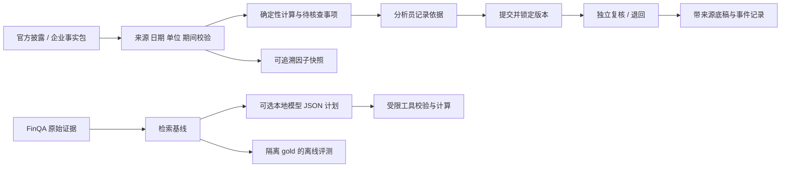

# CreditLens

### 企业信用复核工作台 · Evidence-first credit review

**Turn financial disclosures into traceable facts, reproducible calculations, and reviewable decisions.**

CreditLens 面向企业信用研究中的一个具体任务：财报发布后，分析员核对现金流、债务口径与跨期变化，记录尚未解决的问题，再把有依据的底稿交给复核员。系统将来源、计算、问题处理和版本记录保存在同一案件里。

**v0.4 是可运行的企业工作流原型。** 已有官方 HTML/PDF 披露案例、原页坐标、口径校验、独立复核、权限隔离测试与金融证据实验室；尚未完成生产银行部署、通用 PDF/扫描件解析或真实模型效果评测。当前底稿由模板生成，可选本地模型规划接口已实现并通过模拟传输测试。

## 从一个真实披露案例开始

<details>
<summary>查看真实运行界面（模拟复核身份）</summary>

</details>

1. 选择微软 FY2025（20 项事实）或苹果 FY2025（22 项事实）案例，设置研究截止日期；PDF 案例带原页位置。
2. 检查原始显示值、单位、期间、重复冲突和披露时间，重算现金流、现金转化与短债覆盖。
3. 把资本开支占用、债务覆盖范围等问题转成待核查事项，记录依据与限制。
4. 提交后锁定版本，由独立复核身份确认或退回；导出带公式、来源与事件记录的底稿。

本例经营现金流 **136,162 百万美元**、固定资产现金支出 **64,551 百万美元**，简化自由现金流 **71,611 百万美元**。经营现金流下降 20%、资本开支不变的情景值为 **44,378.6 百万美元**。情景是假设，不能当成预测；历史案例不代表当前最新财务状况。[原始现金流量表](https://www.microsoft.com/en-us/investor/earnings/fy-2025-q4/cash-flows) · [实际运行底稿](artifacts/review-memo.md)

## 运行

Python 3.11+。从仓库根目录运行；本轮使用 Windows / Python 3.12.14。

```bash
python -m venv .venv
# Windows PowerShell
.venv\Scripts\python.exe -m pip install -r requirements.lock
.venv\Scripts\python.exe -m uvicorn creditlens.api:app --host 127.0.0.1 --port 8765
```

macOS / Linux 将 Python 路径换为 `.venv/bin/python`。主工作台使用仓库内的小型财务事实包，**无需 GPU、模型密钥或下载完整基准**。

打开 [信用复核工作台](http://127.0.0.1:8765/) → “打开所选官方案例” → “核查与复核”。演示模式可切换分析员、复核员与访客，身份明确标为模拟。API-key 模式由服务端绑定用户、角色和工作区，配置见 [部署与模型接口](docs/07-operation-and-model.md)。

在“官方案例来源”选择微软或苹果的“PDF 原页”，建案后进入“证据台账”可查看页码链接和坐标。重跑原始 PDF 提取时再安装可选依赖：

```bash
python -m pip install -r requirements-pdf.lock
python scripts/build_pdf_pack.py --download --render-dir .run/pdf-preview
python scripts/build_apple_pack.py --download --render-dir .run/pdf-preview
```

完整 PDF 和渲染页只保存在本地，工作台使用已生成的最小事实包。

需要 FinQA 实验室时执行 `python scripts/download_data.py`，下载后重启服务并访问 `/lab`。

## 已实现的业务能力

| 复核中的问题 | 实现 | 重要边界 |
|---|---|---|
| 数字难回到原文 | 事实 ID、官网链接、HTML 概念定位、PDF 页码及金额/表头坐标、文件哈希 | 两家公司的固定 PDF 版式，共 6 页；不含 OCR 或通用表格发现 |
| 数量单位或期间混用 | 类型化事实、Decimal、同单位与同期间检查；显式周历财年 | 未覆盖全部合并口径、租赁与受限现金调整 |
| 原始值与归一值不符、负值情景失真 | 显示值精确核对，限制符号转换；百分比下降情景只适用正经营现金流 | 内部一致性不等于材料真实性 |
| 更新后仍复核旧规则结果 | 旧案保留可读、可导出，停止写入；核查材料后重新建案 | 尚无新旧案件自动关联 |
| 混入未来披露 | 按公告日期过滤，不可用材料阻断 | 今天抓取的网页不能冒充历史归档 |
| 风险提示没有后续处理 | 逐项说明、提交、退回、独立复核 | 演示规则未用违约标签标定 |
| 重复创建、并发覆盖 | 幂等键、版本校验、事务冲突返回 409 | 单机 SQLite，未做大规模负载验收 |
| 不同工作区数据混读 | API-key、角色权限、租户查询约束 | 尚无 SSO、企业密钥轮换及生产运维 |
| 复核过程不可解释 | 事件哈希链、快照校验、可导出底稿 | 数据库所有者可重算哈希，非外部防篡改存储 |
| 模型随意计算或编造来源 | 本地模型只能提受限 JSON 计划，验证器读取原单元格计算 | 模拟接口测试通过，未公布真实模型成绩 |
| 因子研究无法追溯 | 导出 5 个带来源的观察因子 | 单公司无标签样例，不能直接训练预测模型 |

## 证据与实测

```bash
python -m unittest discover -s tests -v
python scripts/evaluate_controls.py  # 官方参考 + 明确标记的反事实控制场景
python scripts/demo_workflow.py
python scripts/export_factors.py
python scripts/evaluate_retrieval.py  # 需要先下载 FinQA
```

| 验证 | 当前结果 |
|---|---|
| 核心、API、权限、并发、时点与模型接口测试 | 86 项通过 |
| 财务控制回归场景 | 15/15 通过；1 个官方参考、14 个人工修改副本，不是模型准确率 |
| 官方 PDF 开发样例核对 | 微软 20 项与 HTML 一致；苹果 22 项与登记参考一致，均非盲测或真实性验证 |
| 官方披露工作流复现 | 5 个事件，独立模拟身份，事件校验通过 |
| FinQA dev 页内 BM25，883 题 | Macro evidence Recall@5 = 82.43% |
| 全部标注证据取回 | 625 / 883 = 70.78% |
| 真实模型推理、SFT/DPO、金融预测 | 尚未执行 |

本轮新增 [第二家公司与口径修正](docs/iterations/2026-10-25-04.md)：分行日期、同名债务分区、现金与流动投资分项、52 周财年及完整模拟复核。苹果 [22 项参考核对](artifacts/aapl-pdf-crosscheck.json) 是开发验证；微软 [20 项跨格式核对](artifacts/pdf-crosscheck.json) 保留原记录。15 个财务控制场景包含在 86 项测试中。以下截图属于 v0.3；开头概览保留自 v0.2。

<details>
<summary>查看 PDF 原页证据台账</summary>

</details>

检索分数**不是端到端问答准确率**。运行时仅导入原始段落、表格与问题，gold 答案、程序和预置检索结果保留在离线评测路径。API 权限测试使用合成身份，不代表真实机构验收。

[检索逐题结果](artifacts/retrieval-baseline.json) · [复核流程输出](artifacts/workflow-demo.json) · [因子快照](artifacts/factor-snapshot.json) · [验收记录](docs/06-implementation-status.md)

苹果案例的流动资金来自两个原始单元格，债务区分流动与非流动分区。缺分项、单位冲突或合计与分项并存时阻断，完整公式进入 [实际底稿](artifacts/apple-review-memo.md)。[v0.4 概览截图](docs/images/apple-review-workbench.png) · [分区定位截图](docs/images/apple-evidence-workbench.png)

## 系统结构



FastAPI、Pydantic、Decimal、SQLite 构成模块化单体。研究路线沿同一业务任务扩展：**金融多模态文档理解 → 可核验因子 → 模型风险评测 → 人工复核**。长文档、视觉检索与后训练只在基线和数据允许时加入。

## 阅读路线

| 文档 | 解决的问题 |
|---|---|
| [通俗制作报告](docs/iterations/README.md) | 每轮为何做、做了什么、怎样验证 |
| [岗位与企业问题](docs/01-product-and-career.md) | 10 份岗位映射、目标用户与求职路线 |
| [开源与论文](docs/02-open-source-and-papers.md) | 13 个开源项目、首轮 15 项研究与基准 |
| [架构与数据](docs/03-architecture-and-data.md) | 当前实现与完整目标的区别 |
| [实验与 A100](docs/04-experiments-and-compute.md) | 同预算基线、消融、租卡启动条件 |
| [产品路线](docs/05-roadmap-and-github.md) | 下一阶段与展示边界 |
| [运行与模型接口](docs/07-operation-and-model.md) | 身份配置、API、状态存储与模型调用 |
| [文档智能、因子与治理研究](docs/08-document-ai-and-governance.md) | 政策与论文证据、可检验的研究假设 |
| [权威数据登记](docs/09-data-register.md) | 来源优先级、许可与适用性 |

## 数据与贡献

FinQA 来自 EMNLP 2021 作者仓库，固定版本与哈希见 [manifest](data/manifest.json)。企业样例来自微软和苹果的官方披露，保存最小数值事实与来源定位，完整网页不随仓库分发。[第三方说明](THIRD_PARTY_NOTICES.md) 区分代码许可证和原始材料权利。

项目贡献集中在业务工作流、证据契约、可复算工具、验证边界和可复现实验。BM25、视觉检索、QLoRA 与 DPO 都有既有研究；尚未声称算法首创、银行落地、收益提升或违约率改善。

当前可用 CPU 运行。A100 40GB 留给数据与评测准备好后的视觉模型或小模型微调实验。代码采用 [MIT](LICENSE)。
