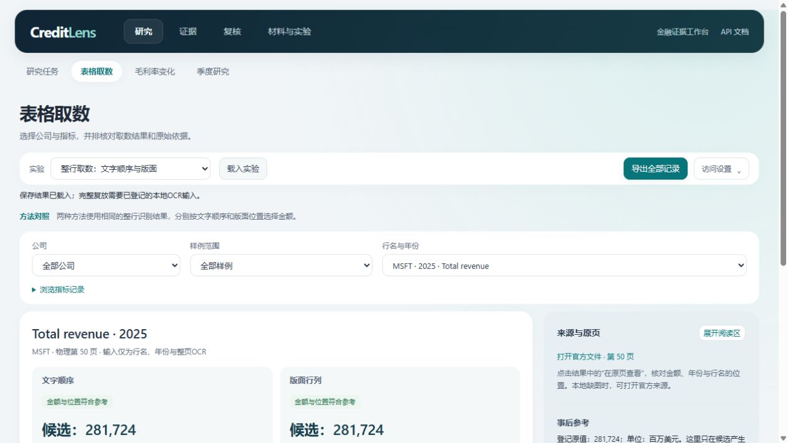
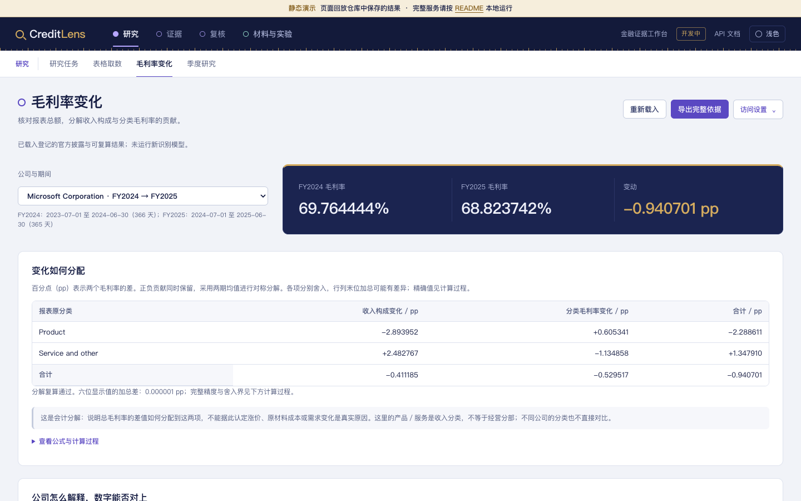
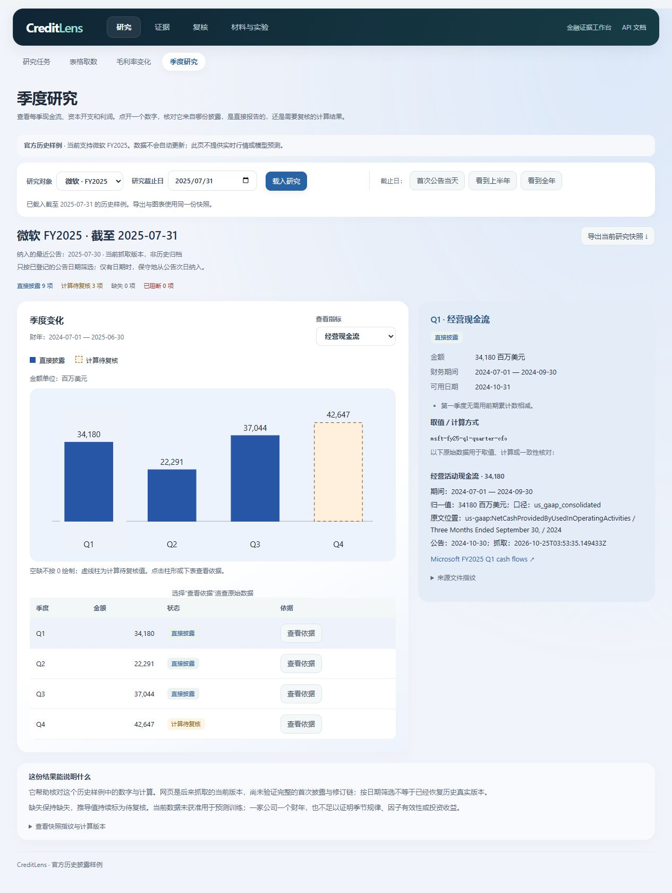
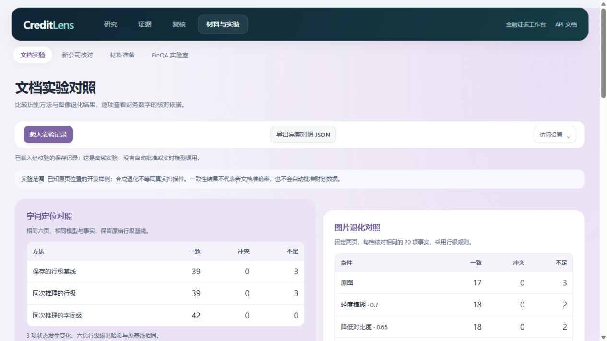

# CreditLens

### 多模态金融证据工作台

CreditLens 面向投研和风险分析中的财报核查：查到指标并回到原文，检查数字是否可比，整理经营变化的依据。数字、计算、公司解释和待验证假设分别保存，研究底稿可以修订、复核和导出。

## 主要功能

| 任务 | 工作台提供的内容 |
|---|---|
| 查指标与原文 | 按行名和年份寻找金额，保留文字、页码及定位证据；同名行可明确选择 |
| 核对财务口径 | 检查单位、期间、范围和披露时间；完整读取单位例外后再展开数量级 |
| 查看经营变化 | 计算各公司自身的年度变化、现金流调节项目及毛利率分解，展示输入和公式 |
| 整理公司解释 | 关联公司说明、数字与业务范围，保留解释主体和未解决的问题 |
| 研究交接 | 记录采用理由、固定提交版本、独立复核或退回；保存不确定时按原请求恢复 |
| 比较文档方法 | 并排查看整行、词级和按证据用途取数，检查失败原因并导出结果 |

当前运行材料以微软、苹果的历史披露为主，文档实验另有 AMD、NVIDIA 案例。OCR 已在 CPU 上运行；页面展示保存的实验结果。底稿使用结构化规则与模板，通用多模态问答、自动公告更新和预测模型尚未实现。

<details>
<summary>查看工作台</summary>









</details>

## 本地运行

Python 3.11+，从仓库根目录执行：

```bash
python -m venv .venv
# Windows PowerShell
.venv\Scripts\python.exe -m pip install -r requirements.lock
.venv\Scripts\python.exe -m uvicorn creditlens.api:app --host 127.0.0.1 --port 8765
```

macOS / Linux 使用 `.venv/bin/python`。工作台使用仓库内的小型财务事实包，当前功能无需 GPU 或模型密钥。

- [研究任务](http://127.0.0.1:8765/tasks)：建立任务、核对材料、记录理由、提交与复核。
- [表格取数](http://127.0.0.1:8765/table-lookup)：选择实验和样例，查看金额、原文位置与单位。
- [经营变化](http://127.0.0.1:8765/margin)：查看毛利率分解及公司说明。
- [文档实验](http://127.0.0.1:8765/experiments)：比较保存的识别结果和失败案例。

演示模式提供模拟角色；API-key 模式由服务端绑定身份、权限和工作区，配置见[运行说明](docs/07-operation-and-model.md)。

## 技术结构


FastAPI / Pydantic 提供接口和输入契约，Decimal 完成金融计算，SQLite 保存版本、事件与事务回执。文档取数保留候选、来源摘要和定位区域；前端隔离切换身份或材料后的迟到响应。检索实验采用 BM25 与受限算术工具，参考答案与运行时检索输入分离。

[架构与数据模型](docs/03-architecture-and-data.md) · [研究任务](docs/20-research-tasks.md) · [保存与提交恢复](docs/40-research-write-recovery.md)

## 数据与复现

企业数据来自官方历史披露，保存必要数值、口径和来源定位；完整 PDF、完整 OCR 和本地数据库不随仓库分发。合成场景与官方事实分别标注。下载工具按登记来源和摘要校验，原始数据按需取得。

[数据登记](docs/09-data-register.md) · [存储与恢复](docs/22-data-storage.md) · [第三方许可](THIRD_PARTY_NOTICES.md)

```bash
python -m unittest discover -s tests -v
python scripts/check_artifacts.py
python scripts/evaluate_unit_applicability.py --verify-saved
```

文档实验的模型、输入和完整复演方法见[OCR 实验说明](docs/13-document-ai-experiment.md)及[复现说明](docs/16-experiment-reproduction.md)。FinQA 页内检索需另按登记版本下载数据，使用 `python scripts/evaluate_retrieval.py` 运行。

| 实验 | 保存结果及适用范围 |
|---|---|
| FinQA 页内检索 | dev 883题，Macro evidence Recall@5 为82.43%；这是证据召回率，不是回答准确率 |
| 表格取数 | 同一批42条登记记录、40组查询比较不同规则，保留取错与不足；详见[方法对照](docs/37-role-aware-table-lookup.md) |
| 单位适用性 | 176次保存材料检查、20种合成场景的100次方法检查；详见[输入、结果与边界](docs/42-unit-applicability.md) |

软件测试、合成控制和真实材料实验分别解释。现有材料属于开发样例，独立人工参考及未参与调参材料的评测仍待完成。来源可追溯和计算一致不代表披露真实性或经营原因已获独立证实。

## 技术文档

- [项目用途与技术实现](docs/12-project-story-and-technology.md)
- [三类研究任务的验收标准](docs/24-research-task-acceptance.md)
- [现金流分解](docs/21-cash-flow-bridge.md)、[毛利率分解](docs/35-gross-margin-bridge.md)与[公司说明核对](docs/36-margin-company-statements.md)
- [同名行选择](docs/38-row-disambiguation.md)、[导出一致性核对](docs/39-row-selection-verification.md)与[独立参考流程](docs/34-reference-review.md)
- [实验设计](docs/04-experiments-and-compute.md)与[模块契约](docs/research/README.md)

后续方向包括跨页续表与图表、同口径历史材料和时序／因子实验。对应任务、数据条件与方法依据见[研究方案](docs/11-financial-research-platform.md)。代码采用 [MIT](LICENSE)，原始数据按各自来源条款使用。
