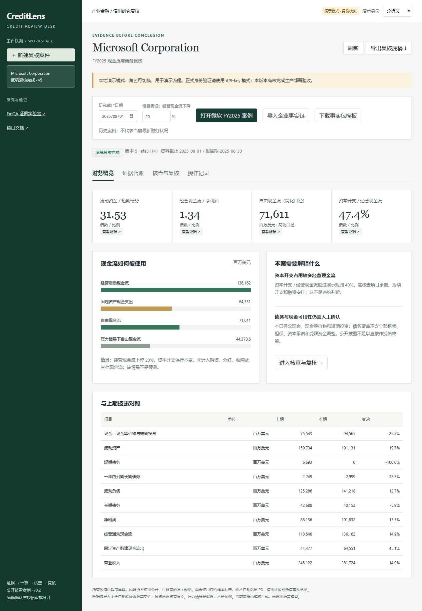
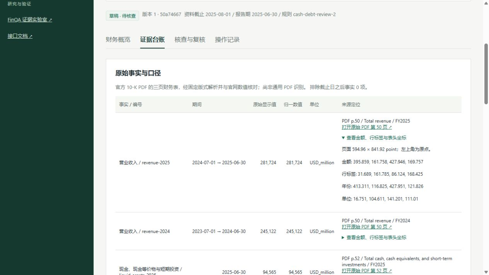
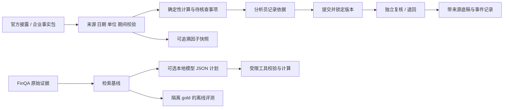

# CreditLens

### 多模态金融证据工作台 · Financial evidence you can inspect

**Find the number. Check the comparison. See what the evidence supports.**

CreditLens 给投研和风险团队做三件事：查到财务指标并回到原文，检查两组数字能不能比较，把经营变化的依据与还没证实的解释分开。先交付可核验的证据工作台，时序预测、因子和更广的研究平台沿这套基础继续建设。

**现在能做什么：** 围绕一个研究问题，把微软与苹果的官方现金流材料放在一起，逐项决定哪些数字可以采用、看各公司自身的年度变化、拆开经营现金流变化、记录尚未查清的解释，再交给另一身份复核。后来补充的公司解释可以另建底稿，记录是否采用、由谁确认以及还缺什么证据。改稿会留下旧版本，口径不同的数字会说明原因。原有工作台还能计算债务指标、按历史日期看季度变化，以及让识别模型读取财报图片并与原始数字核对；原页、识别框和失败原因都能追查。目前可在本机运行，无需显卡。

**接下来准备推出：** 扩充现金流变化的附注与公司解释，补充独立核查题，扩充口径可对齐的同行与多季度材料，研究经营变化的原因；继续完善跨页表格、图表和新旧公告对照，建立现金流预测与因子检验的基线，并提供在线演示。

**后续探索方向：** 联合数字、文字和图表分析企业，研究多尺度时序预测、金融因子、企业关系及风险变化，再扩展到计入交易成本的投资组合实验。模型是否有效，要用未参与调参的公司和未来时段检验；不可靠的结果应显示原因并转交人工。具体设计参考吴庆耀老师参与的相关论文及既有顶会、金融期刊研究，见 [平台方向与论文分析](docs/11-financial-research-platform.md)。

当前底稿由模板生成；已实际运行 OCR 图像文字识别，尚无通用多模态问答、语言模型质量或预测结果，也未部署到金融机构生产环境。具体实现、测试和限制见下方说明。

[项目做什么、企业为什么需要、技术如何实现](docs/12-project-story-and-technology.md) · [独立调研建议](docs/research/README.md)

[并行迭代与验收规则](docs/15-parallel-iteration.md)

[工作台新版界面](docs/images/workspace-palette-desktop.png)：六个业务页面统一为 Times New Roman 与宋体排版、浅灰导航和蓝色操作按钮；[本轮记录](docs/iterations/2026-10-25-17.md)。

新增[现金流逐行拆解](docs/21-cash-flow-bridge.md)：从净利润到经营现金流，检查哪些报表项目推动或抵消了变化，再把原页依据与待查问题一同交接。[实际界面](docs/images/cash-flow-bridge-desktop.png) · [完整底稿](artifacts/research-cash-flow-demo.json) · [本轮记录](docs/iterations/2026-10-25-19.md)。

新增[研究任务与版本交接](docs/20-research-tasks.md)：把问题、数字、采用理由、待查解释和复核记录放到同一份底稿中。微软与苹果的财年不同，当前展示自身年度变化，不作同行排名。[桌面界面](docs/images/research-tasks-desktop.png) · [真实演示导出](artifacts/research-task-demo.json) · [本轮记录](docs/iterations/2026-10-25-18.md)。此前的[港大实际项目调研](docs/research/2026-10-25-hku-industry-projects.md)与[公开模型和基准](docs/research/2026-10-25-hku-team-projects.md)继续作为设计参照，不属于本项目合作经历。

新增 [AMD 固定规则检查](docs/19-issuer-evaluation.md)：先固定参考和规则，再让模型看另一家公司的财报；不确定的货币符号与金额保留待查。页面可以切换 AMD 与 NVIDIA，追查原页并导出。此前的 [新公司文档核对](docs/17-new-issuer-transfer.md)：查看 NVIDIA 材料中的数字、年份和原页，区分参考坐标错误与核对规则不足，并保留每次实验。[日期关联对照](docs/18-date-association.md) 可以按共同表头查看受影响数据，比较规则修改前后的依据。此前的 [字词与退化对照](docs/iterations/2026-10-25-11.md)、[季度研究页面](docs/iterations/2026-10-25-09.md) 继续可用。

[三项业务场景与可复演流程](docs/research/2026-10-25-research-scenarios.md)：基于官方财务事实演示正常交接、退回重提和缺证据留待补充，角色与协作意见保持模拟来源。[运行清单与底稿](artifacts/research-scenarios/manifest.json)。

新增[金额与符号核对](docs/23-currency-evidence.md)：检查货币符号、正负号和金额是否属于同一列；保留旧失败、完整原词及拒绝原因，并将人工反例单独展示。[实际界面](docs/images/currency-diagnostic-desktop.png) · [本轮记录](docs/iterations/2026-10-25-20.md)。

[数据存放与按需恢复](docs/22-data-storage.md)：GitHub保存公开场景、结果和来源索引；原始大文件按需取得，正常演示使用小型事实包。

新增[三类任务检查](docs/24-research-task-acceptance.md)：查指标、比同口径变化、整理经营解释证据分别检查。每项显示依据和缺口；已复核也不会把待验证假设改成已证实原因。[实际页面](docs/images/research-acceptance-desktop.png) · [本轮记录](docs/iterations/2026-10-25-21.md)。

新增[公司解释与金额对应](docs/25-company-attribution.md)：核查微软怎样解释现金流变化，保留主要原因与抵消项；按单位和披露精度核对正文数字。公司说法与独立证实分开，新补充不会继承旧底稿审批。[本轮记录](docs/iterations/2026-10-25-22.md)。

新增[解释补充底稿](docs/26-explanation-review.md)：后来找到的公司说法有单独的采用理由、提交版本和复核记录；原底稿保持原样，待补证据不会因复核完成而消失。[本轮记录](docs/iterations/2026-10-25-23.md)。

## 数据是否实时，需要服务器吗

当前使用已整理的官方历史披露样例。界面会即时计算已有数据，但不会自动获取最新财报、公告或行情，也没有持续更新的预测。开发过程中的每小时迭代不是产品数据刷新服务；历史样例中按公告日筛选信息也不等于在线抓取。

| 事情 | 当前状态 | 资源安排 |
|---|---|---|
| 财报核对、季度整理和指标计算 | 本地运行，尚无真实模型训练 | CPU 可完成当前功能，无需租训练卡 |
| 自动跟踪公告与更新研究数据 | 待实现；计划保留发布时间、抓取时间、版本和失败状态 | 需要持续运行的数据任务；可以先在本地验证，上线后再配置普通服务器 |
| 对外提供在线工作台 | 待部署；GitHub 当前展示代码、文档和保存的结果 | 需要应用托管、数据库和访问控制；不因此必然需要 GPU |
| 运行现成模型 | 本机 CPU 已运行 OCR；语言模型规划接口仍仅通过模拟测试 | OCR 复现使用可选依赖；其他模型接入另测，付费服务须另获费用授权 |
| 训练时序模型或微调多模态／语言模型 | 尚未开始 | 先冻结数据、跑基线和准备脚本；确有收益时再评估单张 A100 40GB 的短租实验 |

新公告进入系统时应先更新数据、检索和计算，通常不需要重新训练模型。训练用于改善可测量的任务能力，不能替代资料更新。具体租卡计划见 [实验与算力](docs/04-experiments-and-compute.md)。

## 从一个真实披露案例开始

<details>
<summary>查看真实运行界面（模拟复核身份）</summary>

</details>

1. 选择微软 FY2025（20 项事实）或苹果 FY2025（22 项事实）案例，设置研究截止日期；PDF 案例带原页位置。
2. 检查原始显示值、单位、期间、重复冲突和披露时间，重算现金流、现金转化与短债覆盖。
3. 把资本开支占用、债务覆盖范围等问题转成待核查事项，记录依据与限制。
4. 提交后锁定版本，由独立复核身份确认或退回；导出带公式、来源与事件记录的底稿。

本例经营现金流 **136,162 百万美元**、固定资产现金支出 **64,551 百万美元**，简化自由现金流 **71,611 百万美元**。经营现金流下降 20%、资本开支不变的情景值为 **44,378.6 百万美元**。情景是假设，不能当成预测；历史案例不代表当前最新财务状况。[原始现金流量表](https://www.microsoft.com/en-us/investor/earnings/fy-2025-q4/cash-flows) · [实际运行底稿](artifacts/review-memo.md)

## 运行

Python 3.11+。从仓库根目录运行；本轮使用 Windows / Python 3.12.14。

```bash
python -m venv .venv
# Windows PowerShell
.venv\Scripts\python.exe -m pip install -r requirements.lock
.venv\Scripts\python.exe -m uvicorn creditlens.api:app --host 127.0.0.1 --port 8765
```

macOS / Linux 将 Python 路径换为 `.venv/bin/python`。主工作台使用仓库内的小型财务事实包，**无需 GPU、模型密钥或下载完整基准**。

打开 [研究任务](http://127.0.0.1:8765/tasks)，建立任务 → 查看原文并填写采用理由 → 保存并查看变化 → 填写资料缺口 → 提交复核。复核员可退回补充，重提后旧版仍能导出。[步骤与技术说明](docs/20-research-tasks.md)。

打开 [信用复核工作台](http://127.0.0.1:8765/) → “打开所选官方案例” → “核查与复核”。演示模式可切换分析员、复核员与访客，身份明确标为模拟。API-key 模式由服务端绑定用户、角色和工作区，配置见 [部署与模型接口](docs/07-operation-and-model.md)。

在“官方案例来源”选择微软或苹果的“PDF 原页”，建案后进入“证据台账”可查看页码链接和坐标。重跑原始 PDF 提取时再安装可选依赖：

```bash
python -m pip install -r requirements-pdf.lock
python scripts/build_pdf_pack.py --download --render-dir .run/pdf-preview
python scripts/build_apple_pack.py --download --render-dir .run/pdf-preview
```

完整 PDF 和渲染页只保存在本地，工作台使用已生成的最小事实包。

打开 [文档视觉核对](http://127.0.0.1:8765/documents)，可查看仓库内保存的真实 OCR 记录，筛选“证据不足”，对照登记值、识别文字与原因。首次下载仓库不会带上原页图片；需要看图或重跑模型时，在已激活的虚拟环境运行：

```bash
python -m pip install -r requirements-ocr.lock
python scripts/evaluate_document_ai.py --download --local-dir .run/document-ai
```

该命令仅下载已登记的官方 PDF（缺失时），使用本地预训练 OCR 权重在 CPU 上识别无标记整页图像，再核对已有事实。首次安装依赖需要联网，正式识别不调用云 API。配置、模型哈希与运行记录见 [实验说明](docs/13-document-ai-experiment.md)；原始 PDF、完整 OCR 和整页图片不进入 Git。页面读取保存结果，点击“载入”不会重新运行模型。

打开 [文档实验对照](http://127.0.0.1:8765/experiments)，无需模型或原页即可查看已保存的字词／行级与图像退化实验、展开失败原因、导出对照。完整重跑默认写入独立的 `.run/reproductions/`，不会替换页面展示的记录或已有原页。使用 `scripts/check_document_reproduction.py` 比较候选与冻结实验的逐字段证据；完整命令、差异说明与发布边界见[安全复现说明](docs/16-experiment-reproduction.md)。

打开 [新公司文档核对](http://127.0.0.1:8765/transfer)，默认查看 AMD 固定规则后的检查记录，也可切换 NVIDIA 的已保存开发诊断，筛选待检查项、展开证据并导出。AMD 来源与复现见[本轮说明](docs/19-issuer-evaluation.md)。页面保留原年份不足的结果，并提供完整日期关联后的对照；按共同表头查看受影响数据、切换原页日期和金额位置、导出依据。这是已观察材料的诊断，未变成盲测成绩。原页准备见[实验说明](docs/17-new-issuer-transfer.md)，新规则重算见[日期关联](docs/18-date-association.md)。

需要 FinQA 实验室时执行 `python scripts/download_data.py`，下载后重启服务并访问 `/lab`。

打开 [季度研究工作台](http://127.0.0.1:8765/research)，选择日期、查看变化，点“查看依据”追查数字，再导出当前快照。试选“首次公告当天”与“看到上半年”，查看尚未披露的数据如何保持缺失。网页与以下命令行共用计算模块，不需要网络或模型：

```bash
python scripts/export_quarters.py --as-of 2025-07-31
python scripts/export_quarters.py --as-of 2025-01-30 --output .run/earlier-quarter.json
```

[查看季度输出](artifacts/quarterly-snapshot.md)。前三季采用直接披露值，第四季由全年减九个月得到并标为待复核；缺数不填零，公告当天的数据保守地从次日开放。完整来源与限制见 [数据登记](docs/09-data-register.md)。这是单公司数据准备样例，还不能支持预测模型有效性结论。

## 已实现的业务能力

| 复核中的问题 | 实现 | 重要边界 |
|---|---|---|
| 数字难回到原文 | 事实 ID、官网链接、HTML 概念定位、PDF 页码及金额/表头坐标、文件哈希 | 两家公司的固定 PDF 版式，共 6 页；不含通用表格发现 |
| 文本读数与页面不一致 | 整页 OCR 后按位置逐项核对金额符号、年份、期间、单位文字、行标签和分区；原页叠加查看 | 已知位置开发实验；模糊跨列保留证据不足，一致也不自动批准 |
| 数量单位或期间混用 | 类型化事实、Decimal、同单位与同期间检查；显式周历财年 | 未覆盖全部合并口径、租赁与受限现金调整 |
| 原始值与归一值不符、负值情景失真 | 显示值精确核对，限制符号转换；百分比下降情景只适用正经营现金流 | 内部一致性不等于材料真实性 |
| 更新后仍复核旧规则结果 | 旧案保留可读、可导出，停止写入；核查材料后重新建案 | 尚无新旧案件自动关联 |
| 混入未来披露 | 按公告日期过滤，不可用材料阻断 | 今天抓取的网页不能冒充历史归档 |
| 风险提示没有后续处理 | 逐项说明、提交、退回、独立复核 | 演示规则未用违约标签标定 |
| 重复创建、并发覆盖 | 幂等键、版本校验、事务冲突返回 409 | 单机 SQLite，未做大规模负载验收 |
| 不同工作区数据混读 | API-key、角色权限、租户查询约束 | 尚无 SSO、企业密钥轮换及生产运维 |
| 复核过程不可解释 | 事件哈希链、快照校验、可导出底稿 | 数据库所有者可重算哈希，非外部防篡改存储 |
| 模型随意计算或编造来源 | 本地模型只能提受限 JSON 计划，验证器读取原单元格计算 | 模拟接口测试通过，未公布真实模型成绩 |
| 因子研究无法追溯 | 导出 5 个带来源的观察因子 | 单公司无标签样例，不能直接训练预测模型 |
| 单季、累计和披露时间混用 | 四次官方披露、季度与累计交叉检查、按截止日导出、推导值单独标注 | 网页与命令行共用；一个财年、无修订链、非历史归档，不支持周历季度 |

## 证据与实测

```bash
python -m unittest discover -s tests -v
python scripts/evaluate_controls.py  # 官方参考 + 明确标记的反事实控制场景
python scripts/demo_workflow.py
python scripts/export_factors.py
python scripts/evaluate_retrieval.py  # 需要先下载 FinQA
```

| 验证 | 当前结果 |
|---|---|
| 核心、API、权限、并发、时点、季度数据、视觉核对与模型接口测试 | 535 项运行：533 通过，2 项平台权限跳过 |
| 财务控制回归场景 | 15/15 通过；1 个官方参考、14 个人工修改副本，不是模型准确率 |
| 固定任务开发检查 | 36项符合预期，19项登记材料用例、17项合成控制；人工独立确认0，非自然语言问答评测 |
| 固定规则后的 AMD 检查 | 两页14项：行级10一致4不足；字词／日期规则12一致2不足，日期新关联应用0次；非盲抽取准确率 |
| 金额符号开发诊断 | 已观察AMD 14项复算，仅2项增加关联；34项独立人工控制通过，旧报告保持不变；非模型泛化准确率 |
| 官方 PDF 开发样例核对 | 微软 20 项与 HTML 一致；苹果 22 项与登记参考一致，均非盲测或真实性验证 |
| 官方披露工作流复现 | 5 个事件，独立模拟身份，事件校验通过 |
| FinQA dev 页内 BM25，883 题 | Macro evidence Recall@5 = 82.43% |
| 全部标注证据取回 | 625 / 883 = 70.78% |
| 真实 OCR 页图核对 | 六页、42 项开发事实：39 项字段一致，3 项证据不足，0 项明确冲突；不是通用抽取准确率 |
| 字词定位对照 | 同次行级保持 39/3；字词级 42 项一致、0 不足，仅原来 3 项改变；已知开发位置，非泛化准确率 |
| 合成图像退化 | 两页四档共 80 项条件结果；原图/JPEG 各 17 一致、3 不足，模糊/低对比度各 18/2；非真实扫描集 |
| 新公司文档诊断 | NVIDIA 两页 16 项，修正参考后复用首次 OCR；两法均 0 完整一致、16 不足，均因年份规则；非盲测 |
| 真实 LLM/VLM 问答、SFT/DPO、金融预测 | 尚未执行 |

第 7 轮新增 [平台方向与季度数据模块](docs/iterations/2026-10-25-07.md)，含 17 项数据与解析测试。此前的 [第二家公司与口径修正](docs/iterations/2026-10-25-04.md)、苹果 [22 项参考核对](artifacts/aapl-pdf-crosscheck.json) 和微软 [20 项跨格式核对](artifacts/pdf-crosscheck.json) 保留原记录，均为开发验证。15 个财务控制场景已包含在软件测试中。v0.7.1 新增安全复现与逐项对照，Windows 本地跳过的是文件符号链接权限场景，目录 Junction 与硬链接已实际检查，见 [第 13 轮](docs/iterations/2026-10-25-13.md)。以下截图属于 v0.3；开头概览保留自 v0.2。

<details>
<summary>查看 PDF 原页证据台账</summary>

</details>

检索分数**不是端到端问答准确率**。运行时仅导入原始段落、表格与问题，gold 答案、程序和预置检索结果保留在离线评测路径。API 权限测试使用合成身份，不代表真实机构验收。

[检索逐题结果](artifacts/retrieval-baseline.json) · [复核流程输出](artifacts/workflow-demo.json) · [因子快照](artifacts/factor-snapshot.json) · [验收记录](docs/06-implementation-status.md)

苹果案例的流动资金来自两个原始单元格，债务区分流动与非流动分区。缺分项、单位冲突或合计与分项并存时阻断，完整公式进入 [实际底稿](artifacts/apple-review-memo.md)。[v0.4 概览截图](docs/images/apple-review-workbench.png) · [分区定位截图](docs/images/apple-evidence-workbench.png)

## 系统结构



FastAPI、Pydantic、Decimal、SQLite 构成模块化单体。上图是已经实现的复核基础；季度研究已接入网页，文档图像核对由离线 CPU OCR 生成记录、只读 API 与原页查看器展示。平台目标是在共用数据与证据基础上接入**多模态研究、时序与因子、企业关系、组合实验和模型治理**，不表示这些模型已实现。实验任务、数据门槛和顺序见 [完整方向](docs/11-financial-research-platform.md)。

## 阅读路线

| 文档 | 解决的问题 |
|---|---|
| [通俗制作报告](docs/iterations/README.md) | 每轮为何做、做了什么、怎样验证 |
| [产品需求与企业问题](docs/01-product-requirements.md) | 目标用户、企业问题与公开需求依据 |
| [开源与论文](docs/02-open-source-and-papers.md) | 13 个开源项目、首轮 15 项研究与基准 |
| [架构与数据](docs/03-architecture-and-data.md) | 当前实现与完整目标的区别 |
| [实验与 A100](docs/04-experiments-and-compute.md) | 同预算基线、消融、租卡启动条件 |
| [产品路线](docs/05-roadmap-and-github.md) | 下一阶段与展示边界 |
| [研究任务与固定底稿](docs/20-research-tasks.md) | 逐项采用、口径阻断、人工解释、独立交接和历史导出 |
| [运行与模型接口](docs/07-operation-and-model.md) | 身份配置、API、状态存储与模型调用 |
| [文档智能、因子与治理研究](docs/08-document-ai-and-governance.md) | 政策与论文证据、可检验的研究假设 |
| [真实 OCR 实验与复现](docs/13-document-ai-experiment.md) | 图像输入、核对规则、模型版本、失败案例与原页展示 |
| [固定规则后的新发行人检查](docs/19-issuer-evaluation.md) | AMD参考预检、来源事件区分、冻结运行与失败解释 |
| [日期关联与新旧规则对照](docs/18-date-association.md) | 表头分组、日期与列归属、非年份保护和完整 OCR 核验 |
| [新公司诊断与参考修正](docs/17-new-issuer-transfer.md) | NVIDIA 来源、可见页坐标、失效记录、同一 OCR 重评分及工作台 |
| [权威数据登记](docs/09-data-register.md) | 来源优先级、许可与适用性 |
| [时序与因子研究计划](docs/10-time-series-and-factors.md) | 已发表论文依据、季度现金流任务、因子稳定性与样本外实验 |
| [金融研究平台与吴庆耀相关论文](docs/11-financial-research-platform.md) | 扩展后的产品定位、多模态／时序／关系／组合研究与实施顺序 |

## 数据与贡献

FinQA 来自 EMNLP 2021 作者仓库，固定版本与哈希见 [manifest](data/manifest.json)。企业案例来自微软和苹果的官方披露，另有 NVIDIA 独立文档诊断参考，保存最小数值事实与来源定位，完整网页不随仓库分发。[第三方说明](THIRD_PARTY_NOTICES.md) 区分代码许可证和原始材料权利。

项目贡献集中在业务工作流、证据契约、可复算工具、验证边界和可复现实验。BM25、视觉检索、QLoRA 与 DPO 都有既有研究；尚未声称算法首创、银行落地、收益提升或违约率改善。

当前可用 CPU 运行。A100 40GB 留给数据与评测准备好后的视觉模型或小模型微调实验。代码采用 [MIT](LICENSE)。
