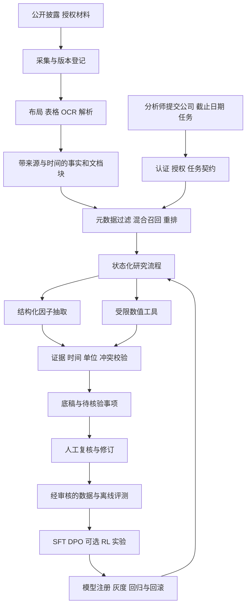

# 系统架构与数据方案

2026-10-25 更新：整体目标已按用户要求扩展为多模态金融研究与风险分析平台，见 [最新方案](11-financial-research-platform.md)。本文描述的信用研究流程是其中的基础模块，新增季度数据契约在 `creditlens/temporal.py`；关系模型、预测和组合研究仍待实现。

## 用户路径和系统边界

完整版本按任务组织，入口包括公司研究、跨期变化检查和风险事件跟踪。一次任务先确定企业主体、合并口径、报告期间和信息截止时间，再找材料。系统输出底稿，人工复核后才能进入机构自己的审批流程。

当前工作台 v0.4 已实现官方财务事实包、固定 PDF 原页定位、单位/期间/时点校验、案件复核状态机、API-key 身份与租户约束、事件记录，以及 FinQA 页内检索和受限本地模型接口。其外新增季度数据研究脚本；未修改工作台业务规则。模型接口仅做模拟传输测试，尚无真实模型质量结果。未完成通用 PDF 解析、生产认证集成或训练。当前实现详见 [验收记录](06-implementation-status.md)，下文区分目标架构与后续研究。

## 完整目标架构

第一部署形态是模块化单体加后台 worker。API、解析和推理分开进程，避免一次大文件解析拖住所有请求。先用 PostgreSQL、对象存储和可替换检索接口；量级需要时再引入 OpenSearch、独立向量服务和任务队列。不同时堆叠多个 Agent 框架、多个向量库和多个训练平台。

## 关键模块与取舍

| 模块 | 首选方案 | 选择理由／扩展条件 |
|---|---|---|
| API 与任务契约 | FastAPI、Pydantic，版本化请求响应 | Python 与训练代码衔接；严格拒绝额外字段 |
| 业务事实 | PostgreSQL，开发阶段 SQLite | 事务、事实版本与关系查询；生产 RLS 需要独立验收 |
| 原始文件 | 内容寻址对象存储 | SHA-256、采集时间、文档版本；不能只存向量 |
| 文档解析 | Docling 与 MinerU 对照后定型 | 重点检查中文表头、跨页表、单位、附注 |
| 检索 | BM25 基线 → dense + RRF → reranker | 每增加组件都需等预算消融 |
| 编排 | 明确状态机；复杂阶段接 LangGraph | 重试、暂停、人工复核和有限预算可检查 |
| 生成模型 | 模型接口隔离；4B 本地基线与强模型对照 | 模型可以替换，不把业务逻辑写进某家 API |
| 推理 | vLLM 候选 | 测首 token、吞吐、KV cache、并发与成本 |
| 追踪 | 结构化日志 → OpenTelemetry／Langfuse | 能解释一次答案经过哪些证据和操作 |
| 关系分析 | 关系表优先，按需图检索 | 担保链和股权链任务证明收益后再增加图数据库 |

## 事实与证据契约

完整版本至少保存以下对象：

- Document：document_id、tenant_id、company_id、原始 URL、来源机构、文档类型、公告时间、采集时间、内容哈希、版本、权限和授权范围。
- Evidence：document_id、页码、文本或表格定位、原文、表头、抽取方式、解析器版本、质量状态。
- Fact：指标名、Decimal 数值、币种、数量单位、会计期间、合并／母公司范围、会计标准、证据引用、有效时间、修订关系。
- Calculation：公式 ID、公式版本、输入事实 ID、中间结果、输出单位、异常状态。
- Claim：事实或推断类型、证据和计算引用、时间适用范围、是否需要人工复核。文本不能冒充已核验事实。
- Run：任务、模型 revision、prompt 版本、数据版本、检索预算、工具轨迹、费用、耗时、错误和人工操作。

数值一律使用 Decimal 或等价明确精度格式。金额缺失不能当成零；百分比与百分点分开。母公司现金不能直接除以合并债务，年度现金流不能默认为时点现金。股权关系或风险因子在证据不足时保留“未知”。

当前新增 CasePack、Source、Fact、复核案件与事件契约，可拒绝已支持公式的不同单位/期间输入。FinQA 实验室的通用单元格工具仍需人工确认金融量纲；完整合并范围、会计准则和修订链尚未实现。

## 时点回放与防止信息泄漏

financial_period、published_at、ingested_at 是三个不同字段。2024 年报可能在 2025 年公布，不能把年份当作公开时间。严格研究使用 published_at ≤ cutoff；线上回放还需要保存当时实际可获得的版本。只有今天的修订后网页，即使带早期报告日期，也不能声称是当年的原始快照。

修订报告保存为新版本并记录 supersedes。缓存键包括租户、授权版本、公司、截止时间、语料版本、模型及 prompt 版本。删除或撤权后清理检索索引、派生结果、缓存及允许清理的日志副本。基础模型本身可能记得未来信息，因此答案只能引用当前任务证据；额外做反事实与未来干扰测试。

FinQA 不提供可信的原始公告时间，当前严格 as_of 模式会返回证据不足。这是明确的数据边界；不会通过猜日期提高完成率。

## 数据分层

| 数据 | 用途 | 当前状态与授权边界 |
|---|---|---|
| [FinQA](https://github.com/czyssrs/FinQA) | 数值问题、表文证据、程序化评测 | 已下载官方 dev 883 题，固定 commit 与哈希；仓库 MIT，原始报告权利另看 |
| [TAT-QA](https://arxiv.org/abs/2105.07624) | 表文混合与单位处理 | 后续接入；先核对官方数据仓库的具体许可 |
| [FinanceBench](https://arxiv.org/abs/2311.11944) | 外部财报 QA 验证 | 公开 150 题作外部检查，不将其当成大规模训练集 |
| [Finance Agent Benchmark](https://arxiv.org/abs/2508.00828) | 跨文档研究任务 | 需要搜索工具与成本预算；不和封闭检索分数混比 |
| [FinSearchComp](https://arxiv.org/abs/2509.13160) | 大中华区与时效金融搜索 | 先核查发布文件与许可，再做独立测试 |
| [FinFIRST](https://huggingface.co/datasets/inclusionAI/FinFIRST) | 原子答案与证据评价 | 后续外部测试候选；保持测试隔离，不用于调参 |
| [SEC EDGAR](https://www.sec.gov/search-filings/edgar-application-programming-interfaces) | 原始披露、XBRL facts、公告元数据 | 官方 API 无需 key；遵守识别请求方、限流与缓存规则 |
| 中国上市公司官网、交易所、巨潮公告 | 中文信用研究语料 | 原始来源与公告日期逐条登记；公开可读不等于无限再分发或训练授权 |
| 内部尽调、授信及违约表现 | 真实业务验证、后期 PD | 当前没有，不用合成数据冒充银行真实样本 |

SEC 官方 API 提供提交历史及 XBRL 财务数据。[官方接口说明](https://www.sec.gov/search-filings/edgar-application-programming-interfaces) 自动访问需遵循网站限制，官方公告给出合计不超过每秒 10 个请求的上限；项目默认使用更低速率并处理 429 与重试。[SEC 限流说明](https://www.sec.gov/filergroup/announcements-old/new-rate-control-limits)

后续拟建设 30 家非金融企业、约 200–300 份中英文披露材料的小语料库；这是计划规模。先选一个行业建立一致口径，再扩大行业，避免仅用六家幸存科技公司得出普遍结论。具备授权前只公开 URL、哈希、脚本和可公开标注，不把受限研报或商业数据库内容提交 GitHub。

## 标注与数据质量

自建评测集首批拟 200 题，包含直接事实、两步计算、跨文档事件、冲突信息、资料不足和日期陷阱。证据标注到原文位置或单元格；标注答案、允许误差、单位、期间和需要全部出现的证据集合。至少 20% 双人复核，分歧保留并仲裁；金融含义请专业人士抽查。

训练、开发和测试按公司及报告分组，并增加时间外测试。相同文件的不同问题、重发公告、模板高度重复材料不能跨边界形成泄漏。开源基准可能已进入基座预训练，因此额外使用后续公开的新报告和可控数值替换任务。

当前检索只读 pre_text、post_text、table；运行时删除 gold_inds、model_input、program、answer 和上游检索结果。原始含标签文件仅供离线评测，不能直接作为 Agent 上下文。

## 企业部署需要补齐的能力

身份提供方认证、数据库与检索前权限过滤、网络出站白名单、文件解析隔离、工具 allowlist、日志脱敏、密钥管理、请求限流、任务幂等、断点恢复、备份恢复和模型回滚，均需要可执行验收。SQLite 事件哈希链不能阻止数据库持有者重写全链；目前 API-key 与租户约束不等于完成 SSO 或生产身份治理。

中国金融数据场景需按具体机构与业务核对分类分级、委托处理和第三方管理要求。[金融监管总局数据安全管理办法](https://www.nfra.gov.cn/cn/view/pages/ItemDetail.html?docId=1192308&itemId=926) 提供需求来源，本项目不会据此宣称已获得合规认证。
