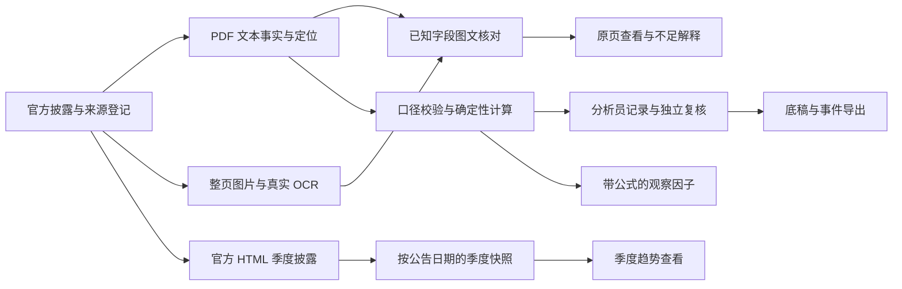

# CreditLens：简历项目描述与技术讲解

更新：2026-10-25（Asia/Shanghai）。当前可用稿基于已合并并本地验收的 v0.11.0；两组并行实验和比较页面见[第 11 轮](iterations/2026-10-25-11.md)，安全复现与逐项对照见[第 13 轮](iterations/2026-10-25-13.md)，新公司诊断与参考修正见[第 14 轮](iterations/2026-10-25-14.md)，日期关联对照见[第 15 轮](iterations/2026-10-25-15.md)。后续实验仍须审查、合并和验证后才能更新成绩。项目属于研究与开发原型，不是金融机构任职经历或已投产系统。

## 可直接放入简历的版本

**CreditLens｜多模态金融研究与风险分析平台（研究与开发项目）**

**技术栈：** Python、FastAPI、Pydantic、SQLite、PDFium、RapidOCR、ONNX Runtime、BM25、GitHub Actions

面向投研与风险分析场景，构建连接官方财报、图像识别、财务计算、季度研究与人工复核的工作台，让研究数字可追溯、异常可定位、分析结果可交接。

- **财务数据与时点管理：** 将微软、苹果官方披露整理为带来源哈希、页码、坐标、单位和期间的结构化事实，使用 Decimal 与规则校验金额、符号和财务口径；新增带符号的经营现金流调节表核对，保留逐行变化、公式和来源；构建按公告日期过滤的季度快照，区分直接披露、差分计算与缺失值。
- **文档图文核对：** 实现整页图像 OCR 与 PDF 文本层的字段核对，覆盖金额、年份、期间、单位、行标签和分区；通过原生字词坐标与字符／符号保护处理跨列歧义，六页已知位置开发事实从行级 39/42 一致变为字词级 42/42；保留原基线、原页定位及失败理由，另完成两页四档合成退化对照。扩展 NVIDIA 诊断，修正可见页面原点偏移与裁切字符风险，保留原年份失败，新增严格日期关联及按共同表头核查，逐字段证明金额保护未改变。
- **金融检索与可复算工具：** 在 FinQA dev 883 题上建立隔离答案标签的页内 BM25 检索基线，证据 Macro Recall@5 为 82.43%；实现引用原单元格的受限算术执行与结构化计划校验，保留数据来源、公式和中间步骤。
- **研究任务与版本交接：** 实现跨公司材料采用／拒绝、基于口径的年度计算和人工候选解释；提交时固定问题、来源、采用理由、缺口与结果，复核绑定版本及快照摘要，参与编辑者禁止自审；支持退回重提与旧版导出。微软、苹果两期样例只计算各自变化，跨公司口径不同则阻断排名。
- **工作流与工程验证：** 实现分析员提交、独立复核、版本冲突检查、幂等操作、API-key 角色与租户约束、事件链与底稿导出；建立隔离实验输出及逐项证据对照工具，配置 CI 回归。453 项软件测试本地运行，452 通过、1 项平台权限跳过，包含 15 个财务控制场景。

数字应连同限定范围保留。空间不足时可删掉指标，不把“页内证据召回”改成“金融问答准确率”，也不把“已知位置开发核对”改成“通用文档识别准确率”。投递前按本人实际能够解释和演示的内容取舍；项目起止日期按真实经历填写。

## 更紧凑的三条版本

- 构建面向投研和风险分析的金融研究工作台，打通官方披露整理、财务口径校验、季度快照、证据追溯和独立复核流程。
- 以 PDF 文本与真实整页 OCR 两条读取路径核对数字及表头，将跨列、缺失和不确定结果保留待查，支持原页定位和逐字段解释。
- 建立 FinQA 页内检索基线及引用式数值工具，落实身份隔离、幂等、版本控制和实验复现；使用自动化回归与 CI 检查已有功能。

## 在校研究背景怎样讲

**建议标题：CreditLens｜面向金融研究的多模态证据建模与可靠性评估。** 可放在“研究与项目经历”中；香港大学作为本人就读背景。项目身份、起止时间和导师指导关系按实际经历填写，学校身份不等于某个公开课题的参与证明。

**当前可以使用的背景描述：**

> 在香港大学学习期间，围绕金融数据分析与可信AI开展研究和原型开发。针对财报格式不统一、识别错误难定位、数字口径与披露时间容易混用的问题，设计并实现 CreditLens：将官方披露中的财务事实与原页证据对应，比较文本与图像识别结果，保留不确定项，支持财务计算、季度观察和独立复核，为后续现金流预测与因子研究提供可追溯的数据基础。

技术描述接前面的已实现成果，不把表格预训练、预测或用户试用写进已完成部分。若描述导师课题经历，应补入本人实际承担的研究任务、交付物及与本项目的关系；公开搜索到的项目只能作为研究参照，不能替代这些经历信息。需求目前来自公开披露、岗位要求及文献分析；没有开展访谈的部分不写成“根据合作企业用户反馈迭代”。

### 可以建立的研究联系

完整出处、技术联系与背景稿见[港大相关课题调研](research/2026-10-25-hku-research-context.md)。其中区分已发表论文、研究目标、历史产业案例和本人经历，不把项目目录当作完成效果证明。

扩展调研见[实际产业合作与公开交付](research/2026-10-25-hku-industry-projects.md)和[团队模型、代码与基准](research/2026-10-25-hku-team-projects.md)。LITE Lab 与 Microsoft 的尽调和时间线配方，适合参考研究任务的材料范围、冲突处理和导出；历史企业文档 PoC 适合参考原型如何接到工作流程；德勤合作调查提醒我们把协作和效果测量写进验收。由这些参照形成的[研究任务](20-research-tasks.md)已完成材料采用、自身年度变化、人工解释和版本交接；严格同行比较和因果证据仍待补齐。

### 面试时把项目故事讲完整

> 我在香港大学学习期间围绕金融数据分析和可信 AI 做研究与原型开发，CreditLens 是这条方向上的项目。它面向投研和风险团队，想解决的是从分散材料到可交接研究结论的过程。比如看到一家企业利润上升、现金流下降，先要确认数字的年份、单位和经营范围，再回查附注，才能讨论原因。我已经实现官方事实登记、图文核对、确定性计算、季度观察和独立复核，也保留了金额符号和日期关联失败的真实案例。调研港大公开的企业文档工作流和金融信息关联项目后，我把工作落实为跨公司现金流研究任务，先接通采用理由、实际口径和复核快照。现在用两家公司的年度样例计算各自变化，口径不同时保留限制；已经把调节项目接入研究，下一步补查附注原因，再用合格历史数据检验时序预测和因子有没有增量价值。

这段讲解不必堆会议和模型名称。被追问时，用当前代码与失败记录解释取舍；项目关联背景使用本人实际课题名称和承担模块，公开案例作为方法来源即可。

港大金融科技研究目录列有 **TabGPT**，研究异构金融表格的表示和泛化；另有**企业数字足迹的经济应用**，摘要披露了行业数据伙伴合作。它们分别说明财务表格建模和多源信息研究是实际研究主题，目录里的目标和项目方效果不属于 CreditLens 的成果。[官方课题目录](https://fintechacademy.hkubs.hku.hk/research-projects/)

更明确的历史产学案例是港大数据科学实验室与 **ImpactInvest** 于2021年开展的金融AI合作，将新闻、价格及环境因素联系起来，用可视化帮助研究人员查找关联信息。可借鉴其“多源信息难查找”的问题定义，不能将对方的合作、数据、预测模型或反馈写成本人的经历。[校方项目介绍](https://saasweb.hku.hk/datasci/files/Using%20AI%20on%20the%20Ontology.pdf)

对于 CreditLens，研究问题落在：识别后的数值能否回到正确单元格；版式或符号变化会不会使错误进入下游；什么条件应保留人工复核。现在已有可重跑的图文核对与失败记录；多模态检索问答、跨页理解、时序和因子有效性仍是研究计划。

## 完整技术描述

### 要解决的问题

分析员研究一家公司时，需要把财报数字、附注解释和历史变化放在一起。真正耗费精力的环节包括找到原始依据、确认单位与期间、区分当时已公开和后来补充的信息，以及让复核员重现计算过程。材料转成文字以后，串列、漏负号和口径混用还可能悄悄进入因子或预测。

CreditLens 先建立可以查证的数据与流程基础：数字从哪里来、为什么这样计算、哪些地方不确定、谁处理和确认过。经营趋势、因子、时序预测与企业关系共享这套基础；当前预测和关系模型还没有完成。

### 数据与计算层

用 Pydantic 约束 Fact、Source、财务期间和 PDF 定位信息，保留原始显示值与归一值。用 Decimal 完成确定性计算，校验单位、年份、期间、缺失、重复冲突和允许的符号转换。派生指标保存公式与输入事实 ID，不让模型自由生成数值。

季度模块按已登记公告日期生成快照；只有日期而没有准确发布时间时，从次日纳入。单季直接披露优先，全年减累计得到的季度值标为待复核。当前样例是微软一个财年，不是完整历史 Point-in-Time 数据库，也没有修订版本链。

### 图像与文本层

将经过哈希校验的官方 PDF 渲染为无标记整页图像，在本机 CPU 上运行 RapidOCR 的 PP-OCRv6 small 检测／识别制品，由 ONNX Runtime 执行。模型仅接收图片，不读取登记金额、参考框或 PDF 文本。

识别完成后，程序将像素坐标转换为 PDF 坐标，按事先定义的空间规则寻找候选，分别检查金额符号、年份、期间、单位文字、行标签和分区。低分、跨列、多义或缺证据保留“不足”；有明确不符记“冲突”；全部必需字段一致才记“一致”。一致也不会自动批准事实。OCR 分数不是校准后的正确概率。

v0.7 增加字词位置对照：同轮行输出与原基线逐页哈希一致，字词位置解决三处串列；字符必须守恒，相关原始行或邻近负号／数字碎片不能消失。另固定原图、轻度模糊、降对比度和 JPEG 四档条件，保留全部结果。`/experiments` 比较方法与失败，鉴权 API 检查来源、配置、完整性与汇总，导出同一快照。两个实验都用已有预训练模型在 CPU 推理，没有训练。

运行记录保存模型、包、权重、配置、图像和来源指纹。API 读取时对照源事实重算字段及汇总，拒绝不一致记录；页图请求验证身份、登记路径和图像哈希。完整 PDF、整页图和完整 OCR 留在本机，公开结果只保留必要片段。

v0.7.1 将重跑输出与冻结结果隔离。只读对照器逐字段检查结果、位置、父行、符号保护和证据摘要，把时间、耗时与实现哈希变化单列；不根据总计数相同就宣布一致。三组真实 CPU 重跑经完整输出复算，原网页依据与预览保持不变。这是已有案例的可复现性检查，没有新增泛化分数。

v0.8 增加新发行人诊断与参考质量控制。首次 NVIDIA 参考坐标错误如实记为无效，通用转换根据可见 MediaBox/CropBox 交集确定原点，裁切字符拒绝进入参考。修正版复用同一完整 OCR，保留原始输入、配置、来源和失效记录。16 个金额字段一致，但全部完整事实因年份规则不足保留待核；这是已观察材料的诊断，不能称为盲测或模型提升。工作台展示字段、原页和失败解释，图片摘要绑定载入的快照，防止更新后新图配旧坐标。

v0.8.1 在独立版本中增加完整日期与年份关联，只修正可证明属于同一日期的数字碎片，不改变金额及其他字段检查。NVIDIA 两页、四个共享表头影响的16项事实在开发诊断中一致；原来的16项不足完整保留。这不是16个独立测试样本或OCR模型提升。另以七个本地原始文件核验输入和父行索引，完整结果逐字段一致。页面按表头组织相关项目，导出同源新旧记录；中文日期、多行日期和新发行人泛化仍待验证。

v0.9.0 在AMD材料识别前固定源文件、14项参考、13份运行依赖、2份参考准备文件及六个执行库版本，完成两页真实CPU检查。行级10项一致、字词级12项一致，2项货币符号合并仍不足；新日期关联应用0次，没有日期规则增益结论。七份完整输入、公开父行与三法字段逐项复算一致。该发行人未用于此前规则调整，但这是已知位置小样本检查，不是预训练未见或盲抽取准确率。页面可切换这一评估与NVIDIA开发诊断。

### 检索与工具层

FinQA 实验只检索题目给定页的原始段落与表格，答案、gold 程序和预置检索结果不进入索引。BM25 基线衡量支持证据是否被取回，不能推出回答正确率。数值工具按引用读取原单元格，限制加减乘除与执行步数；可选语言模型接口仅能提出受限 JSON 计划，不执行任意代码。

该语言模型接口已通过模拟传输验证，尚无真实 LLM/VLM 回答质量、微调或 Agent 端到端完成率结果。真实 OCR 推理与模拟语言模型接口在文档中分别登记。

### 协作与验证层

FastAPI 提供接口，SQLite 存储案件、处置和事件。API-key 模式由服务端绑定用户、角色及租户；提交后锁定版本，另一复核身份才能确认或退回。幂等键和事务内版本检查处理重复请求与并发更新。事件链及快照核验用于发现不一致，但不能抵御拥有数据库写权限者重算全链。

自动化测试覆盖数值边界、未来信息、身份隔离、状态转换、重复请求、并发、模型传输、季度数据与视觉核对，其中包括官方参考及明确标记的合成财务控制场景，另行报告这些场景的结果。软件测试、检索评测、OCR 开发实验和界面验收各自报告，避免混成一个“模型准确率”。

图文核对目前是独立只读页面，尚未作为信用复核的自动批准或阻断条件；图中的并列流程不表示所有模块已自动联动。

## 每项描述的证据在哪里

| 简历主张 | 代码／结果 | 限定范围 |
|---|---|---|
| 财务事实、口径和精确计算 | [diligence.py](../creditlens/diligence.py)、[PDF 登记](../data/examples/msft-fy2025-pdf.json) | 固定公开案例；不鉴定材料真实性 |
| 季度快照与可得时间 | [temporal.py](../creditlens/temporal.py)、[季度输出](../artifacts/quarterly-snapshot.json) | 一家公司、一个财年；无完整修订链 |
| 真实 CPU OCR 与字段核对 | [运行脚本](../scripts/evaluate_document_ai.py)、[视觉规则](../creditlens/visual.py)、[实验记录](13-document-ai-experiment.md) | 42 项已知位置开发事实；不是盲测 |
| 检索召回 82.43% | [原始逐题结果](../artifacts/retrieval-baseline.json)、[core.py](../creditlens/core.py) | FinQA dev、页内检索；非问答分数 |
| 受限模型计划 | [planner.py](../creditlens/planner.py)、[测试](../tests/test_planner.py) | 真实模型效果未测；接口测试用模拟响应 |
| 独立复核与权限 | [workflow.py](../creditlens/workflow.py)、[API](../creditlens/api.py)、[工作流测试](../tests/test_workflow.py) | 模拟用户与本地演示；无银行生产验收 |
| 日期规则与完整输入复核 | [日期规则](../creditlens/date_evidence.py)、[报告重算](../creditlens/date_diagnostic.py)、[原始输入核验](../scripts/verify_date_raw.py)、[本轮验收](../artifacts/date-diagnostic-verification.json) | 仅已观察NVIDIA的4个表头、16项事实；非年份字段保持不变，原失败仍保留 |
| 冻结规则后的新发行人评估 | [评估契约](../creditlens/issuer_evaluation.py)、[运行记录](../artifacts/issuer-evaluation-report.json)、[完整核验](../artifacts/issuer-raw-verification.json) | AMD两页14项；12一致2不足，日期新关联0次；观察后成为开发材料 |
| v0.9远端回归 | [CI 40178340407](https://github.com/leon1111-wgl/creditlens/actions/runs/40178340407) | Linux326项运行、325通过、1项Windows Junction跳过；不代表模型准确率 |
| 软件测试与 CI | [v0.11验收](../artifacts/cash-flow-bridge-verification.json)、[UI与下载](../artifacts/cash-flow-bridge-ui-verification.json) | 当前本地 453 项运行、452 通过、1 项 Windows 文件符号链接权限跳过；15 个控制场景已包含其中。[v0.8.1 远端 CI](https://github.com/leon1111-wgl/creditlens/actions/runs/40176005378) 为285项运行、284通过，Linux跳过Windows Junction场景，文件符号链接场景实际运行 |
| 新公司诊断与参考治理 | [冻结与复算](../creditlens/document_transfer.py)、[保存 OCR 重评分](../scripts/rescore_document_transfer.py)、[几何核验](../artifacts/document-geometry-verification.json)、[首次失效台账](../artifacts/document-transfer-attempts.json) | 一份 NVIDIA 材料、16 项已观察事实；金额一致但年份不足，不构成盲测成绩 |
| 安全复现与证据对照 | [路径保护](../creditlens/experiment_paths.py)、[对照器](../creditlens/reproduction.py)、[真实重跑核验](../artifacts/reproduction-verification.json) | 同一开发材料；公开证据对照与完整 OCR 复算分别记录；不证明新公司泛化 |
| 可追溯观察因子 | [因子输出](../artifacts/factor-snapshot.json) | 5 个观察指标，没有验证 alpha 或 PD |

## 面试讲解：约两分钟

我做的是一个给投研和风险分析使用的金融研究平台。首先解决的是研究数据是否可靠、能否回到原文的问题。比如财报提取出来的金额可能是对的，但年份列错了，或者一个累计数被当成单季值，这些错误会直接影响后面的分析。

我把官方披露整理成带单位、期间、来源和原页位置的事实，再用程序做财务口径校验与计算。同时加入一条真实的图像读取路径：让 OCR 只看完整页图，识别之后才与文本层的已知位置核对。当前开发案例中，模型把部分金额与相邻列的美元符号识别成一段。我保留原基线，再用同轮字词位置解决这三处问题，并检查字符、父行和附近负号是否完整；不按答案挑数字。还固定了四档图像条件，保留每一档的失败。

系统还提供按公告日期的季度快照、来源可追溯的指标，以及分析员提交、独立复核和底稿导出。检索实验用 FinQA 的原始证据建立页内 BM25 基线，评价证据召回；模型提出计算计划时，执行器只允许引用原单元格完成受限运算。

这个项目目前最扎实的部分是金融数据契约、错误边界、真实 OCR 实验和完整复核流程。下一步我会用未见公司、不同版式和退化图像扩展评测，再研究多模态信息对现金流预测和因子的增量价值。预测和训练尚未完成，我会用同任务基线和样本外结果来决定是否值得投入。

## 技术追问准备

| 可能的问题 | 应能讲清的内容 |
|---|---|
| 为什么没有直接让大模型读 PDF 给结论？ | 文本、图像、计算和判断分别验证；引用页正确不代表数字、期间或单位正确。现有 OCR 是可检查基线，后续 VLM 用同一任务比较。 |
| 42/42 是不是识别准确率？ | 不是。已知页面和定位，开发者参考，没有未见公司盲测。要增加保留样本和独立标注，分别看错误放行与拒绝。 |
| 为什么金额里多一个美元符号就保留不足？ | 识别框可能跨进另一年份列，不能只凭字符串包含正确数字证明列归属；需要更细的位置证据。 |
| 如何避免未来信息？ | 以公告可得日期筛选，只有日期时从次日纳入；不把今天抓取的网页声称为完整历史归档。修订链仍待补齐。 |
| 如何防止重复批准或并发覆盖？ | 事务、当前版本校验、状态机和幂等请求；用两个并发更新检验一成一败。 |
| 是否已经有 Agent、预测、微调？ | 有受限模型计划接口和模拟测试；没有真实 LLM 任务质量、预测或训练结果。独立开发顾问不是产品研究 Agent。 |
| 为什么没有现在租 A100？ | 当前数据与 OCR 可在 CPU 运行；训练须先有合法数据、冻结评测和简单基线，GPU 不能替代任务定义。 |
| 新公司实验有没有失败？ | 有。首次参考没换算 PDF 裁剪原点而失效；修正后复用原 OCR，金额对上但日期表头让年份规则全部保留不足。公开保留过程，未把参考修复算模型提升。 |
| 项目的算法创新是什么？ | 当前贡献主要在证据契约、金融规则、失败可解释性与可复现实验。OCR、BM25 和时序候选都有原始工作，不把集成写成算法首创。 |

## 研究计划：单列，不放进已完成经历

近期方向是未见公司与版式评测、更细粒度 OCR 证据、扫描退化与真实扫描件、跨页表格、图表与正文联合理解。时序与因子方向先完成多公司、多季度、修订链和观察时点数据，再比较季节统计、线性／树模型与论文候选；合法行情和成本条件满足后才做收益因子与组合实验。

正式论文与方法取舍沿用 [技术介绍](12-project-story-and-technology.md)、[时序与因子计划](10-time-series-and-factors.md) 和 [平台研究方案](11-financial-research-platform.md)。论文发表记录和原论文成绩属于原作者，本项目不声称已复现或发表。

## 今天及后续怎样更新这份材料

第一版已经能够覆盖项目用途、完整技术流程、可复制简历段落、证据和面试追问。后续并行实验只有在主分支合并、必要测试和结果检查通过后才新增到简历：记录实际样本范围、基线和失败，更新证据映射及日期。若截止当晚仍未完成某项，不使用预计成绩补位；保留这个可用版本并说明未完成部分。

## v0.7 新增成果证据

[字词方法与逐项对照](research/2026-10-25-word-evidence.md) · [合成退化实验](research/2026-10-25-visual-robustness.md) · [比较页面验收](iterations/2026-10-25-11.md)。两页四档合计 80 项条件结果，不能写成 80 份独立财报；42/42 不能省略已知位置开发样例限定。

## v0.10 研究任务新增证据

| 简历主张 | 代码与实测依据 | 适用范围 |
|---|---|---|
| 跨公司材料采用与年度比较 | [材料模块](../creditlens/research_materials.py)、[20项控制测试](../tests/test_research_materials.py) | 两公司八项官方事实；自身年度变化，非同行排名 |
| 完整快照与独立交接 | [任务存储](../creditlens/research_task_store.py)、[存储控制](../tests/test_research_task_store.py)、[HTTP集成](../tests/test_research_tasks_api.py) | 租户、版本、幂等、自审、材料变更、退回重提；本地SQLite |
| 可操作页面与导出 | [界面验收](../artifacts/research-task-ui-verification.json)、[下载底稿](../artifacts/research-task-demo.json) | 本地模拟身份；旧版、新版内容摘要和实际下载均检查，不等于真实机构复核 |

面试可解释的一个真实缺陷：浏览器重写JSON将 `792.0` 变成 `792`，使Python规范化摘要失配；通过原样保存服务端响应修复，并实际下载两个版本逐字节对照。这说明核查范围包括用户真正拿到的文件，而不止后台返回成功。

离线核验命令：`python scripts/verify_research_export.py artifacts/research-task-demo.json`。17项专属测试涵盖摘要改动、浮点字面变化、重复键、非有限数、文件大小及错版复核绑定；这是文件内部一致性验证，不是签名或机构认证。

v0.10已发布的功能提交 `89a3b8e` 通过远端 [CI 40184164499](https://github.com/leon1111-wgl/creditlens/actions/runs/40184164499)，包括实际公开导出文件的离线核验。

## v0.11 现金流分解与场景证据

| 简历主张 | 代码与实测依据 | 适用范围 |
|---|---|---|
| 现金流原表来源登记与安全重建 | [来源加载](../creditlens/cash_flow_sources.py)、[构建脚本](../scripts/build_cash_flow_bridge.py)、[来源控制](../tests/test_cash_flow_sources.py) | 两张已知表、两年52金额；原生PDF提取，非新增OCR成绩 |
| 有符号会计核对与年度变化分解 | [计算模块](../creditlens/cash_flow_bridge.py)、[计算控制](../tests/test_cash_flow_bridge.py) | 四期加总和两组差额；来源、完整行、符号和期间检查，非因果或预测 |
| 新附件冻结且旧底稿兼容 | [任务控制](../tests/test_research_bridge_tasks.py)、[浏览器验收](../artifacts/cash-flow-bridge-ui-verification.json)、[实际下载](../artifacts/research-cash-flow-demo.json) | 原采用状态独立；v1旧导出字节不变，v2附件嵌套摘要检查 |

面试可以讲的设计取舍：苹果样例的利润增长、经营现金流下降，可以从调节表中找到抵消项。但会计贡献不等于经营因果，系统因此保留“需要哪份附注”的问题。为了让后续判断可追查，源事实、计算、采用决定和候选解释分别记录，复核绑定固定版本。这比只输出一段流畅分析更容易查错和交接。

新增[三项模拟业务流程](research/2026-10-25-research-scenarios.md)：正常交接、口径退回重提和证据不足留待补充。通过公开Store接口实际复演，保存[三个终态与四份导出](../artifacts/research-scenarios/manifest.json)。可以写“构建可复演的业务验收场景，验证退回、版本和缺口处理”；不能写成三个真实客户、真实用户反馈或业务成效。
