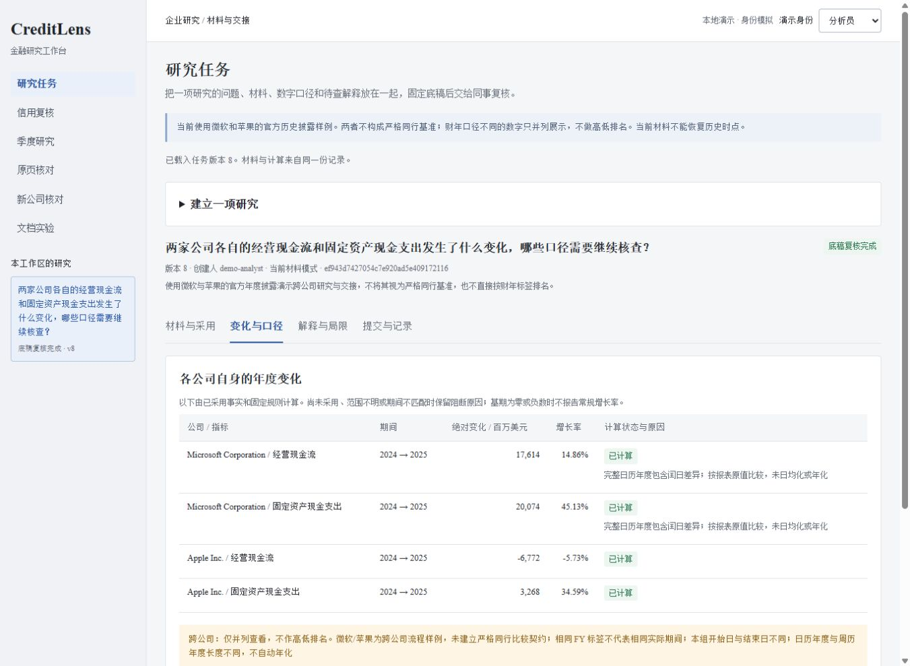

# 把研究材料交接成一份完整底稿

2026-10-25，v0.10.0。入口：[本地研究任务](http://127.0.0.1:8765/tasks)。这是一条已经跑通的研究流程，使用微软和苹果的历史官方披露；两家公司不构成严格同行基准。

## 给谁用，解决什么问题

分析员研究现金流变化时，需要同时保留数字、采用理由、口径限制和待查解释。只传一张计算表，复核员很难知道哪些数据被舍弃、哪一版材料被检查过，修改后旧结论也容易被覆盖。现在可以围绕一个研究问题把这些内容放到同一任务中，再交给另一身份复核。

## 五分钟演示

1. 启动服务，进入 `/tasks`，用演示分析员建立任务，填写问题和材料选择理由。
2. 查看八项现金流事实的原值、括号负号、实际期间、来源链接和合并范围。逐项选择采用或拒绝，并填写理由。
3. 保存后打开“变化与口径”：只有采用且口径满足规则的数据才参与年度变化计算。没有采用的项会保留阻断原因。
4. 在“解释与局限”填写资料缺口，可添加最多三条人工候选解释。状态只有待查和未判断，关联数字不证明原因。
5. 提交底稿，切换演示复核员确认或退回。退回后修订、重提产生新的快照；旧版仍有独立导出入口。

演示身份可自行切换，仅用于展示流程。API-key 模式由服务端绑定用户、角色和租户；工作流阻止创建、编辑或提交过同一任务的用户自审，即便换成复核角色也不允许。生产 SSO、多方真实身份和组织授权尚未部署。



## 为什么没有给两家公司排名

微软这两期的结束日是6月30日，苹果是9月28日／9月27日；前者是日历年度，后者是周历年度。相同的 FY2025 标签不足以说明期间相同。当前模块只分别计算同一份报告中各公司自身的两列年度变化；不自动日均化、年化或生成跨公司名次。

| 公司 / 指标 | 2024原值或流出绝对额 | 2025原值或流出绝对额 | 变化 / 百万美元 |
|---|---:|---:|---:|
| 微软经营活动现金流 | 118,548 | 136,162 | 17,614 |
| 微软固定资产现金支出 | 44,477 | 64,551 | 20,074 |
| 苹果经营活动现金流 | 118,254 | 111,482 | -6,772 |
| 苹果固定资产现金支出 | 9,447 | 12,715 | 3,268 |

数值来自各自FY2025报告及其比较列。原表PPE行的括号负值单独保存，计算列使用流出绝对额，不能将该行扩为所有资本投入。微软两期含365／366天差异，页面提示但不调整原值。合并范围有报表和附注依据；持续／终止经营的进一步分解仍为未知，不能据此推断这类子项。

完整来源页码、原文件哈希、转换和范围证据见[材料说明](research/2026-10-25-research-materials.md)。运行时检查登记包的语义哈希及注册源哈希；不会在每次打开页面时重新下载和重哈希整份PDF。没有证据时拒绝 `historical_as_of` 模式，不能把今日取得的报告当成过去已可得材料。

## 技术实现

`research_materials.py` 只接受服务端登记的材料组，用公司、源文件哈希与事实ID组成全局观察身份。Decimal 计算绝对变化和增长率，保留输入ID、公式、阻断原因；非正基期不输出普通增长率。采用状态独立于OCR核对状态，一致结果不会自动进入研究。

`research_task_store.py` 使用独立SQLite数据库。创建请求绑定租户、用户和幂等键；写入在事务内校验预期版本。提交会固定问题、材料版本、全部采用决定、候选解释、范围说明和计算结果。复核动作必须同时匹配任务版本与快照哈希。退回后可改草稿，已经提交的内容不改写；导出指定版本时只附该版本的复核记录。

快照SHA-256用于检查内容一致性。它不是电子签名，也不能抵抗能同时改数据库内容和摘要的管理员。导出文件保留服务端响应原文，避免浏览器将 `792.0` 重写为 `792` 而破坏当前摘要格式。离线复核采用Python JSON排序键、UTF-8、紧凑分隔符、不允许NaN的格式；不要先经JavaScript重新序列化。

下载后可以独立检查内容摘要、材料摘要和复核所绑定的版本，无需启动服务或读取数据库：

```bash
python scripts/verify_research_export.py artifacts/research-task-demo.json
# 检查自己的下载文件时，把上面的路径替换为该 JSON 文件。
```

工具拒绝重复JSON键、非有限数及超过2MiB的文件，不发网络请求。检查通过只说明文件内部摘要与绑定相符，不证明原始材料真实性、金融计算正确性或复核人的真实身份。复核意见没有独立签名，不能据此证明未被有意重写。

| 接口 | 用途 |
|---|---|
| `GET /api/research/task-materials` | 读取白名单材料及限制，要求身份 |
| `GET/POST /api/research/tasks` | 同租户列表／幂等创建 |
| `GET/PATCH /api/research/tasks/{id}` | 读取／带revision保存采用、解释和范围 |
| `POST /api/research/tasks/{id}/actions` | 提交、独立确认、退回 |
| `GET /api/research/tasks/{id}/snapshots/{snapshot_id}` | 读取指定不可变内容与该版复核记录 |
| `GET /api/research/tasks/{id}/export?snapshot_id=...` | 导出指定版本；省略参数选择当前已提交版本 |

## 实际验证与限制

材料、存储及HTTP测试覆盖八项注册事实、口径阻断、来源改动、幂等冲突、过期版本、身份与租户隔离、参与者自审、退回重提和旧版导出。浏览器实际完成全部交接步骤，新旧两个下载文件均与对应API响应逐字节一致，且内容哈希可复算。保存结果见[演示导出](../artifacts/research-task-demo.json)、[界面与下载检查](../artifacts/research-task-ui-verification.json)。

这是公开样例和模拟身份演示，没有银行用户试用、生产部署或节省工时的实测结论。当前范围仍是一个白名单材料组、八项事实及人工解释；没有通用抽取或自动因果判断。完整横向比较还需要严格同行选择、对齐期间、同口径数据和版本证据；时序与因子实验继续受标签及样本外评估约束。
