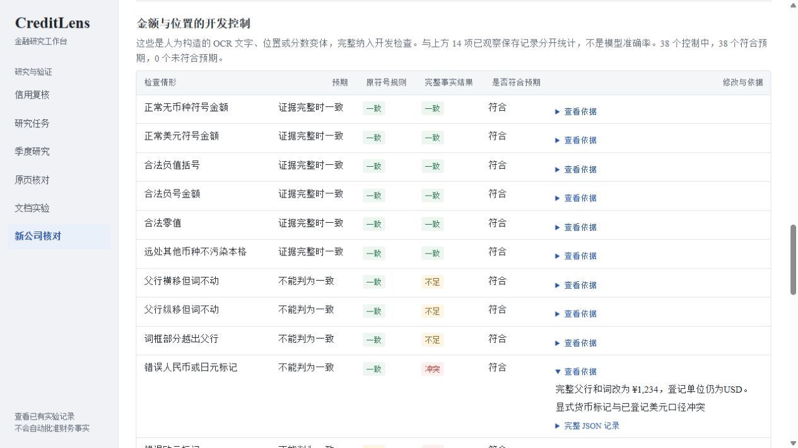

# 金额证据完整性检查

一笔金额的数字正确，还不足以用于研究：币种可能不同，字词框可能挂在另一行，数字旁边也可能漏了负号。本模块在已保存的 OCR 证据上增加检查，尤其检查原规则已经判为一致的金额。

## 使用者怎样核查

打开 `/transfer`，选择“金额证据完整性 · 开发对照”。同一项目保留行级、字词、日期、金额符号和新增完整性检查五列。点击“查看”可追查完整识别文字、父行与字词框、未归属的邻近内容和拒绝原因。下方开发控制单独显示原符号规则与新检查的结果。

如果原页文件不在本地，页面说明原页不可用，仍可检查已保存片段或访问官方来源；不会自动重新下载文件。导出保存服务端返回的原始 JSON，包含规则、来源和范围。它是只读诊断，不能批准财务事实或修改既有底稿。

## 输入、正确标准、错误与恢复

| 项目 | 约定 |
|---|---|
| 输入 | 带期间、单位、位置的登记事实，以及同页的完整父行和字词组；诊断使用已有发行人报告公开的必要片段 |
| 正确标准 | 保留原结果，在空间候选确定后核对完整金额、币种标记、父词关系及固定邻域；不从参考答案挑选词或修数字 |
| 典型错误 | 错币种仍被当成同一数字；父行被移动而词框不动；近邻负号没有词框，因而被旧检查遗漏 |
| 发现方式 | 每项输出具体问题、父行与词索引、原文本和坐标。金额以外的年份、期间、单位文字和行标签检查保持原样 |
| 恢复方式 | 回查原页及识别输出，补齐或更正证据后生成独立的新诊断；保留原文件与失败记录，不直接把不足改成通过 |

`GET /api/evidence-guard` 沿用服务端访问身份。文件缺失返回 503；发布摘要、来源或逐项复算不符返回 409；请求不会启动识别模型或修改数据库。

## 结果适用范围

新增检查不改写原模型推理及原规则报告。已观察发行人的保存证据与人为构造的开发控制分别计数；后者用于发现程序错误，不是人工独立金标准或模型准确率。

单一 `$` 标记与登记的美元口径相容，不代表独立识别出 USD。没有触发守卫，也不能证明被省略的完整 OCR 没有其他内容，更不能鉴定财报真实性。当前检查对象是金额证据；跨页表格、图表估读和开放式问答仍需独立材料与评测。

本层接收已经归一化的 `WordPage`，无法发现转换器此前丢掉的原始四边形异常。原始坐标逐点有限性检查属于另一个待补版本，不以这里的框包含检查替代。

## 已运行的开发检查

- AMD 已观察材料：两页、14 项保存事实，新旧金额规则均为 14 项一致；年份、期间、单位和行标签结果逐项保持原样。这里的一致是与登记参考一致，不是盲测准确率。
- 固定合成控制：8 个合法情况、30 个应阻断情况，38 个均符合设计预期。旧符号规则曾在其中 12 个负例上判为一致，新守卫已阻断。控制的人工独立金标准数量仍为 0。
- 初版守卫将两处拆开的 `$` 视为未归属，得到 12 项一致、2 项不足。修订后只允许同一父行内恰好两个完整词、左侧符号不重叠、距离不超过固定邻域、父框包含且全文守恒的明确关系；错币种、远距离、后缀或多余第三词仍不通过。关系成立也不等于事实批准。
- 完整输入核验只读使用此前保留的 316 条 OCR 父行，对照 35 条公开必要父行；索引映射后，14 项新守卫输出逐字段一致。这是本批保存输入的兼容检查，发布接口只重算公开片段，不冒称每次核验完整 OCR。

结果见[发布报告](../artifacts/evidence-guard-report.json)、[固定控制说明](research/evidence-guard-controls.md)及[浏览器与 HTTP 核验](../artifacts/evidence-guard-http-verification.json)。

```bash
python scripts/evaluate_evidence_guard.py --output my-evidence-guard-run.json
python -m unittest tests.test_evidence_guard tests.test_evidence_guard_diagnostic tests.test_evidence_guard_api -v
```

脚本仅在 `.run/reproductions/` 创建新文件；同名输出已存在会拒绝，不覆盖发布报告。只需仓库内的小型证据和控制，不需要网络、GPU 或原始 PDF。



实现见 [金额守卫](../creditlens/evidence_guard.py)、[诊断复算](../creditlens/evidence_guard_diagnostic.py) 与 [运行脚本](../scripts/evaluate_evidence_guard.py)。
