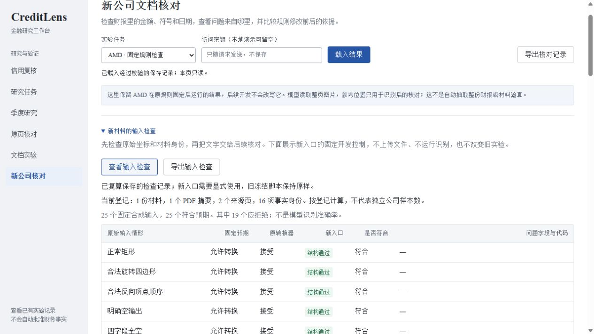

# 新材料的输入检查

分析员看到一页没有结果，应该能分清：这页确实没有文字，识别器没有读出来，还是程序收到了一份损坏的输出。同一份报告换个编号，也不能算成另一份独立材料。这一轮把这两类问题放到转换和统计之前处理。

当前是显式调用的新预检入口。它检查原始 OCR 结构和已经登记的材料身份，产出供后续处理的页面记录；不运行识别模型，不入库，不加入搜索，也不批准财务事实。已有实验脚本和结果保持冻结，尚未全部迁移到新入口。

## 每个模块怎样验收

| 模块 | 输入是什么 | 什么算正确 | 怎样出错、如何发现和恢复 |
|---|---|---|---|
| 原始 OCR 适配 | 页码、页面及图像尺寸、行和字词的原始四角坐标、文字、分数 | 合法输入保留文字和位置；异常在转换前拒绝，返回字段路径 | NaN、越界、布尔坐标、自交框、数组长度冲突等给出稳定错误代码；修正原始输入再调用 |
| 材料身份预检 | 冻结来源清单、参考包及摘要 | 先满足既有来源约束，再排除重复 PDF、重复参考包及重复证据身份 | 同内容换编号不能增加材料数；修订版使用不同资产身份，不按公司名或数值相同简单去重 |
| 单页准备 CLI | 已登记材料的身份声明与原始 OCR | 声明的页码、尺寸和摘要一致，结构检查通过，完整写出独立结果 | 错误输入不留下目标文件；修正后重试；同名结果拒绝覆盖；写入失败不暴露半份结果 |
| 只读诊断页 | 发布清单与固定开发报告 | 原始字节摘要和逐字段重算都一致 | 缺文件返回503，发布或语义漂移返回409；重新检查候选报告，不能只改总分或摘要 |

## 转换之前检查什么

`creditlens/ocr_input.py`逐个检查角点的类型、有限性和图像边界，再检查四角是否组成非退化凸形。允许合法的旋转框、顺时针或逆时针排列；拒绝重复点、自交、凹形和错误点数。检查通过后才换算到页面坐标，不自动裁剪、重排或补齐异常。

例如，旧适配器会在计算包围框时忽略某个位置上的NaN，最后给出一个看起来正常的矩形。新入口会直接指出 `result.boxes[0][2][0]`，不会让错误进入后续金额核对。

空页也有明确契约：四个结果字段全部为空数组、全部为None，以及已核对的RapidOCR 3.10默认空结果结构可接受。`boxes=None`但还有文字或分数会拒绝。显式空字词数组可以保留父行；这不保证后续证据足够，也不代表原图真的没有文字。

四角检查解决的是原始位置输入。词是否属于正确父行、币种和符号是否完整，仍由[金额证据完整性检查](27-evidence-integrity.md)处理。已经转换成矩形的旧OCR记录无法证明转换前的四角有效。

## 材料身份与计数

`creditlens/asset_preflight.py`先执行原有来源、参考包和冻结依赖校验，再检查PDF摘要、参考包原始与规范化摘要、解析后的文件路径、来源页和事实身份。读取清单与参考包后再次绑定同次快照，避免将不同版本的元数据拼在一起。

当前登记清单包含1个PDF身份、1个参考包、2个来源页和16个金额位置。它们是登记计数，不是16个独立样本。相同发行人的不同PDF版本可以并存；不同版本共享同一页图摘要时单独列出内容组，不能把相同页面内容包装成新覆盖面。

此步骤没有读取PDF或图像字节。调用方提供的摘要与登记一致，只能说明声明相符，不能证明实际拿到的文件真实、完整，或确实由某个模型识别过。

## 运行方式

在仓库根目录运行固定开发检查，无需模型或GPU：

```powershell
python scripts/evaluate_document_inputs.py --output document-input-local.json
```

输出位于被忽略的`.run/reproductions/`。重复运行请换一个新名称。即使某项控制失败，也会保存包含全部分母和逐项结果的本地候选报告，再以失败退出；候选不会自动替换公开记录。

处理调用方准备好的单页文件：

```powershell
python scripts/preflight_document_input.py --input .run/raw-page-input.json --output prepared-page.json
```

外层字段为`schema_version=1`、`provenance`、`document_id`、`source_pdf_sha256`、`image_sha256`和`ocr_input`。`provenance`只能为`synthetic`或`caller_declared_model_output`，后者仍是调用方声明。`ocr_input`包含版本、物理页码、页面宽高、图像像素宽高，以及`result`中的`boxes/txts/scores/word_results`。具体约束见[适配器](../creditlens/ocr_input.py)和[输入测试](../tests/test_document_input.py)。

成功结果标记`prepared_not_indexed`，并明确`queryable=false`、`automatic_approval=false`、`database_written=false`。先完整序列化和刷新文件，再用同目录硬链接独占生成目标名；不支持该操作的文件系统会失败退出。这里尚未实现多阶段后台任务、批量入库、重启恢复或删除传播。

## 页面、导出与实际结果

进入“新公司核对”，展开“新材料的输入检查”。页面显示固定预期、原转换器行为、新入口结果和问题字段。访问密钥或实验模式变化会清空旧记录与导出内容，旧请求不能重新填回。下载保存API原始响应字节。



- 25项合成原始输入控制：6项应通过、19项应拒绝，新入口全部符合预期；旧适配器接受了其中11项应拒绝输入。
- 2项资产控制：当前登记通过，同一PDF换编号的合成重复登记被拒绝。
- 本机CLI实际执行错误输入、修正重试和同名覆盖拒绝，见[命令行验收](../artifacts/document-input-cli-verification.json)。原始OCR为明确的合成框，未冒充真实模型输出。
- 浏览器实际载入25行，下载与API响应逐字节一致，身份输入变化后记录清空，见[界面及HTTP验收](../artifacts/document-input-ui-verification.json)。

[固定报告](../artifacts/document-input-checks.json)保留每个输入和失败路径；NaN等特殊值以合成标签编码，不输出非法JSON。报告由发布摘要和完整重算共同验证，不允许只修改计数来伪造通过。以上是软件输入契约的开发控制，独立人工标注题为0，不代表文档问答或模型识别准确率。

跨页表格、图表、原始PDF字节核验、真实原始四角留存及通用入库恢复继续按数据和验收条件推进。已有真实OCR的结果与本轮合成控制分别保存。
