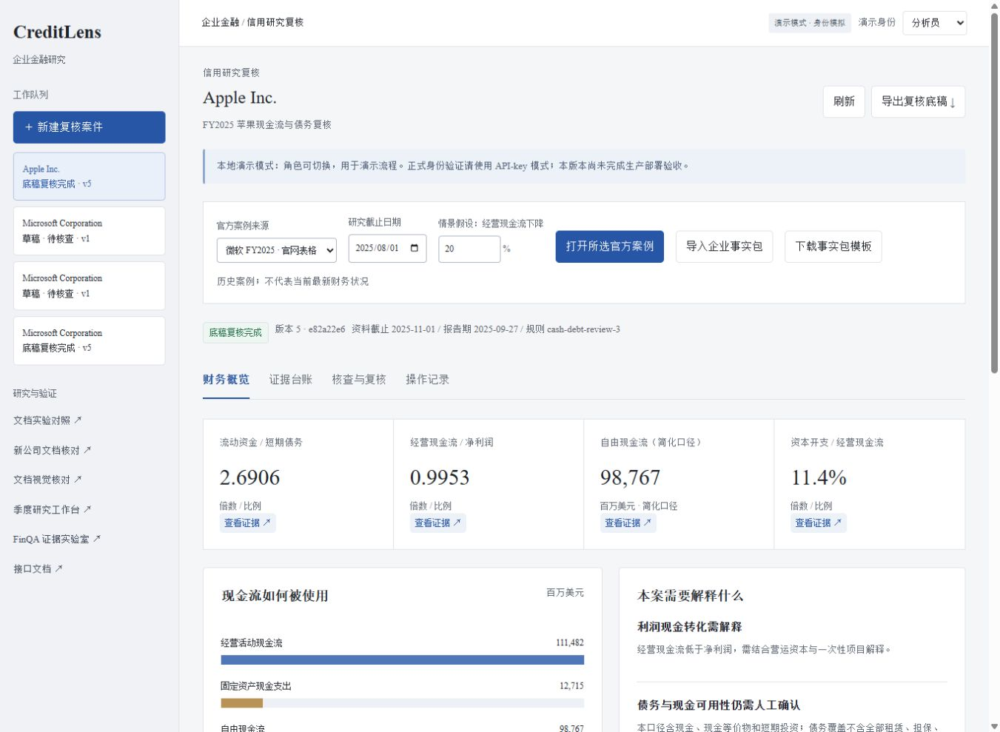

# 第17轮：从真实产业项目完善研究任务，统一工作台配色

日期：2026-10-25（Asia/Shanghai）。本轮接续用户两项要求：调研港大相关团队的项目和产业合作，完善项目故事与技术设计；同时调整整体颜色。功能版本保持 v0.9.0，不新增模型评测成绩。

## 为什么做

一个企业研究项目需要讲清楚谁来使用、完成什么工作、产物如何交接。此前说明已经有文档识别、季度观察和复核，但按模块与论文展开，容易让人误以为所有环节都已接通。界面也存在同样的问题：新版实验页使用白灰蓝，首页和几个旧页面仍保留深绿品牌色及不同字体。

本轮继续沿用2026-10-25的[岗位调研](../01-product-and-career.md)：金融数据处理、可解释计算、文档模型评测与工程协作仍是重点。竞品定位沿用[平台方向](../11-financial-research-platform.md)中的官方工具资料；不重做没有新证据的招聘综述，也不把研究样例称为客户需求验证。此次新增一手证据用于改进任务设计，不用于声称客户或学校合作身份。

## 完成的调研与设计

三个隔离分支分别核验[实际产业合作](../research/2026-10-25-hku-industry-projects.md)、[团队公开项目](../research/2026-10-25-hku-team-projects.md)和[下一阶段研究任务](../research/2026-10-25-enterprise-research-design.md)。重点发现：

- LITE Lab 与 Microsoft 在2026年发布尽调、跨材料时间线等操作配方，可借鉴材料范围、引用、冲突和人工处理；公开配方不等于生产系统验收。
- LITE Lab 的企业文档自动化案例支持从重复劳动出发做原型；德勤与港大的合作调查提醒我们同时衡量协作和落地效果。原项目的客户评价没有转写成本项目反馈。
- ImpactInvest 是有具名伙伴的历史金融信息关联案例；当前部分原站不可达，明确记录仅能读取官方索引，未验证在线演示或收益。
- OHRBench 提供分阶段错误分析思路，但数据限研究、非商用；TRivia 有表格识别代码，可作为独立候选，尚未在本项目运行。TabGPT 的公开研究目标与 UniTabE 的实际论文不混为同一交付。

产品主线收敛为“研究一家公司的现金流为何变化，再与同行比较，交付带证据和缺口的研究底稿”。下一阶段先建立任务与快照，再补齐两家同行、两期年度的可比材料。当前 AMD/NVIDIA 包的年度日期及资本开支范围不一致，不能直接形成同行排名。

设计明确当前材料与历史时点两种模式，规定事实、公司、来源版本的绑定方式，以及复核时冻结数字、证据采用和假设意见的完整版本。没有证据时允许没有解释。新接口和跨公司流程均未实现；时序、因子、预测和训练没有新增成果。

已据此更新通俗故事、平台路线、简历讲解和主页条目，当前技术成果仍沿用已有代码和实验记录。

## 实际完成的界面修改

覆盖 `/`、`/lab`、`/research`、`/documents`、`/experiments`、`/transfer` 六页。使用浅灰导航、白色内容区、低饱和蓝色操作与选中态；绿色用于核对通过，橙色用于不足或假设，红色用于冲突。首页移除深绿侧栏和装饰性英文，增加已有的新公司核对入口。窄屏导航改为紧凑换行。

正文及主要控件采用 Times New Roman，中文回退宋体类字体；正文15px，主标题桌面24px、窄屏22px，二级标题18px。代码、哈希及部分 OCR 原文维持等宽显示。没有引入或声称使用飞书／腾讯官方组件库，也没有新增网络字体请求。

[窄屏截图](../images/workspace-palette-narrow.png)和[验收摘要](../../artifacts/workspace-palette-verification.json)随本轮保存。

## 验证与独立检查

主开发实际查看六页桌面布局及窄屏渲染。497px视口的六页文档可用宽度均为482px，没有整页横向溢出；宽表仍在各自容器中滚动。点击季度Q4依据、执行 FinQA 证据检索、切换信用案件的证据／操作记录／概览均正常。原案件版本保持不变，没有提交复核或修改财务事实。

独立静态审查发现并修复禁用主按钮的级联覆盖、旧棕色焦点样式。五页脚本逐字不变，季度页仅改SVG呈现颜色；剥离颜色常量后六页脚本一致。财务计算、鉴权、写入与模型规则没有改动。主色及状态文字的选定前景／背景组合对比度超过4.5:1；这不是完整无障碍认证。

文档链接、六页JavaScript语法及 Git 差异检查通过。此次未为样式和文档重复运行本地完整模型实验或新增低价值镜像测试；原326项软件测试是v0.9.0已有验证，远端CI在发布后另行检查。

研究顾问还要求把复核快照绑定到文字判断和人工采用版本、给事实增加发行人与披露版本身份，均纳入下一阶段设计。预框表格和自动定位分开评测；暂缓为了消除两个已知OCR不足而直接引入大模型。主开发采纳这些建议，未据此宣称功能已上线。

## 局限与下一步

本轮实际交付的是界面、来源核验、产品故事及可执行设计。未新增数据抓取、完整跨公司任务、模型训练、真实问答质量、机构用户试用、实时信息或在线托管。新版配色已在当前浏览器检查，其他系统字体渲染和完整辅助技术验收仍待做。

下一轮优先完成研究任务与材料适配，补齐可比较的两公司两期披露，再接可比性检查、候选解释、固定快照和独立交接。原冻结实验继续保留。P0可以在CPU上推进，不需要因这轮调研租训练卡。
