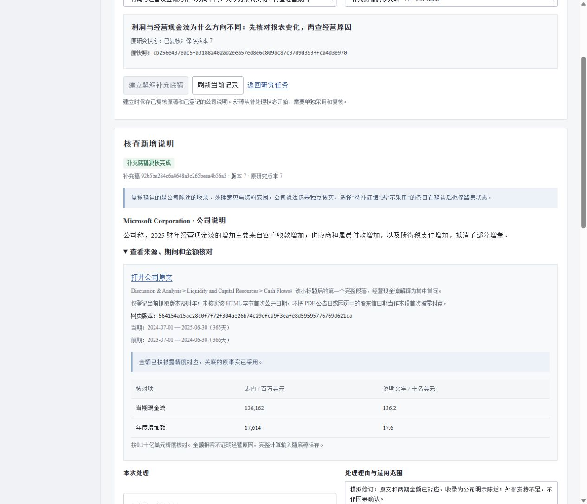

# 第23轮：让新增解释有自己的采用和复核记录

日期：2026-10-25。版本：v0.15.0。本轮沿用同日已核验的岗位、企业文档流程和竞品资料，未新增客户访谈或市场效果结论。

## 为什么做

上轮可以查看微软怎样解释经营现金流变化，但材料只能补充查看。研究人员需要进一步交接时，还缺少三个信息：是否采用、谁确认、当时确认的是哪份材料。若直接把新解释塞进旧底稿，旧审批就可能被误解成也确认了它。

这轮面向分析员和复核员，把这项具体任务做完：从已复核研究建立单独的解释补充底稿，保存处置和核查范围，再独立提交复核。企业需求依据仍为[金融Agent及风险岗位](../01-product-and-career.md)、[公开企业工作流调研](../research/2026-10-25-enterprise-research-design.md)及[港大公开产业项目](../research/2026-10-25-hku-industry-projects.md)。这些资料支持证据交接与协作方向，不证明本项目已有客户或行业领先效果。

## 本轮完成

- 独立证据包：绑定原研究、原快照、公司说明、实际期间、数字核对及原事实采用前提。
- 单独协作流程：收录为公司陈述、不采用、待补证据；保存理由和核查范围，提交、退回、改稿、重提、确认。
- 历史保留：新解释不继承旧批准；原研究和旧补充快照不随新稿改变，已提交版本仍能导出。
- 页面与接口：沿用 Times New Roman／宋体、浅灰蓝工作台；显示日期和采用前提，不能收录的条目保留其他处置路径。导出服务端原响应，避免浏览器重新序列化改变摘要。
- 离线核验：核对内嵌父稿、来源、数字、处置及复核绑定，不依赖现行目录，不把哈希称为身份认证或数字签名。

详细输入、正确标准、错误与恢复见[功能说明](../26-explanation-review.md)。

## 并行审查与取舍

资料分支完成证据契约和离线验证，实验分支完成独立SQLite状态机，main完成接口、页面和完整交接验收。顾问在临时数据库独立运行权限、并发、目录缺失、退回重提和旧导出检查，见[第十四份审查](../research/advisory-14.md)。

采纳并修复三项问题：使用局部Decimal精度避免其他代码污染计算；将短理由校验前移到输入层；页面补上实际期间和采用前提。顾问代码审查与独立代理运行不等于人工标注金标准，正式问答评测仍待建设。

## 仅完成设计与限制

本版固定一条微软官方解释与既有材料包；新增公司及证据必须扩展版本与兼容验证。它没有开放任意来源上传，也没有自动因果识别。页面里的分析员、复核员与处置意见用于模拟软件流程，财务事实保留官方出处；不表示真实机构用户验收。

语义支持范围始终为公司陈述。复核完成不消除“待补证据”，金额一致不证明原因。当前原文页与PDF属于同一份年报，不能被当成两个独立来源。

这轮没有重下原始PDF、整页图或完整OCR，没有GPU训练和付费API。下一轮优先扩充不同支持程度的公司解释及人工独立题，并继续按既定门槛推进跨页／图表和数据恢复；时序、因子及预测保持研究计划。

## 实际验证

- 626项软件测试运行50.917秒，624通过、2项既有Windows符号链接权限跳过；新增51项全部通过。测试数量不是问答或模型准确率。
- 浏览器完成建立、保存、提交、退回、修订、重提、确认7事件，当前补充稿v7，保留v3和v6两份提交快照。
- 真实下载252,198字节，与API原响应逐字节一致；当前与退回导出都通过离线契约。退回导出252,106字节，在重提后不变。
- 原研究导出239,354字节、旧任务检查85,136字节，前后摘要相同；已有89个受版本控制的数据与结果文件保持一致（比较时规范化Git行尾），旧冻结核心未修改。
- 1280px桌面正文宽1265px，497px窄屏正文宽482px，无整页横向溢出；显示两期实际日期、金额和处理前提。浏览器无console错误或警告，新增及修改页面JavaScript语法、Python编译和本地文档链接检查通过。

[完整验收记录](../../artifacts/explanation-review-verification.json) · [最终导出](../../artifacts/explanation-review-demo.json) · [退回导出](../../artifacts/explanation-review-returned-demo.json)

[窄屏截图](../images/explanation-review-narrow.png)。本地新版在8767验收并保留，旧8765/8766未终止；不是公网服务。当前没有需要用户操作的阻塞，也没有新增费用。
