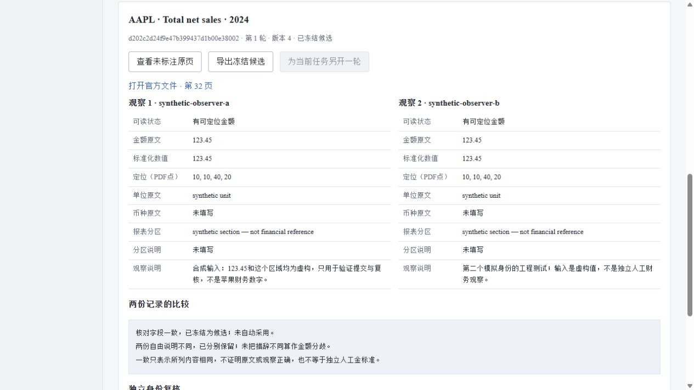

# 第31轮：参考怎样核对，分歧怎样保留

2026-10-26，v0.23.0。给负责文档实验的研究员增加参考核对工作区：两名不同身份分别填写原文依据，收齐后比较，再由未参与填写的复核身份冻结候选。真实人工标注仍待完成，本轮验证使用明确标注的模拟输入。

## 为什么做

上一轮词级取数把4项原本匹配的记录退回不足，没有增加覆盖。继续对同一组旧答案调整规则，难以知道是在修复一般问题，还是只适应这些材料。因此本轮先补参考的核对工具，让来源、观察、分歧和后续修正都可以检查。

使用者是研究员和实验验收人员；直接解决单人填写后难以追查、讨论前已互相抄到答案、参考改动覆盖旧成绩的问题。业务、岗位与竞品依据复用2026-10-25的[产品需求](../01-product-requirements.md)和[企业研究任务设计](../research/2026-10-25-enterprise-research-design.md)，对应文档理解、数据质量、评测和后端协作能力。本轮没有新增客户访谈、商业竞品测试或论文效果复现，不声称优于现有文档平台。

## 本轮完成

- **固定问题与来源。** 42条旧登记去重为40组查询，页面只拿公司、行名、年份、原页与来源摘要，不预填旧金额、参考框或模型候选。完整字面值、负号、坐标范围和单位分别验证；不足或歧义保留空值与原因。
- **分别填写。** 首份观察封存，第二份提交前，其他身份只能看见提交状态，不能通过详情、列表或事件读取内容及摘要。第二份必须来自不同用户ID，不能仅换一个角色。
- **复核与历史。** 两份一致才允许未参与填写的复核身份冻结候选。分歧保留，关闭后另开一轮；已冻结导出不因后来修正改变。来源变化阻止新观察或冻结，关闭旧轮不依赖当前来源，避免恢复流程被锁住。
- **可操作页面。** 原页不带旧标注，支持本人点选区域或填写PDF点坐标；两份内容用并排字段表显示，完整JSON另行展开和导出。换身份或记录时清理旧内容，迟到响应不会覆盖新任务。
- **失败后的确定性。** 创建和提交使用幂等键与版本检查。网络结果不明时保留原请求重试；确认保存后再读取当前版本。读回失败会停止后续写入，避免把旧响应当成最新状态。

每个模块的输入、正确标准、错误与恢复方法见[功能说明](../34-reference-review.md)。观察候选没有自动写入财务事实或旧评测参考的入口。

## 已验证

| 验证 | 结果与适用边界 |
|---|---|
| 新增软件测试 | 22项契约、24项存储与复演、7项API测试通过 |
| 全套回归 | 997项运行，995通过，2项Windows符号链接权限跳过 |
| 页面状态控制 | 实际HTML脚本24项通过；受控响应，不等于真实网络故障注入 |
| 独立顾问联调 | 真实40项目录与临时SQLite的6组隔离、复核和历史控制通过 |
| 合成复演 | 18项通过；3轮、4份虚构观察、1份冻结候选；逐字段重跑一致 |
| 实际浏览器 | 两份模拟观察、第三身份冻结、只读查看、新轮空观察与旧导出保留通过 |
| 原页与下载 | 原页1224×1584像素，无旧框；5,479字节下载在新轮后仍与API一致 |
| 已有内容 | 114个冻结文件、7个旧接口内容保持不变 |

[复演结果](../../artifacts/reference-review-replay.json)、[界面验证](../../artifacts/reference-review-ui-verification.json)和[顾问审查](../research/advisory-22.md)保存了范围与限制。全套回归检查工程行为，不是997道金融问答。

## 审查后的修正

采纳顾问指出的隐藏DOM残留、不确定提交丢失原键、幂等回放显示旧版本三个问题；另外修复来源失效后无法关闭旧轮的恢复缺口。对应页面控制和独立联调已通过。保留精确坐标比较，没有未经验证地增加容差；已有答案公开的事实无法由新界面消除，所以不宣称全应用盲测。

## 尚未完成与下一步

不同API账号不证明不同真人，两份相同观察也不证明正确。候选始终保留`human_gold=false`与`independence_not_verified=true`。本轮的金额、定位、参与者和协作意见是模拟输入；独立人工金标准仍为0，没有新OCR、模型调用、训练、生产部署或用户效率实测。

下一步需要真实人员依据协议核对一小组未参与调参的材料，在查看方法输出前完成记录和分歧处理，再明确哪些候选可以进入独立参考。跨页续表、图表与视觉模型对照仍待数据和验收，时序与因子继续保留研究门槛。本轮没有扩大数据存储或费用授权。

