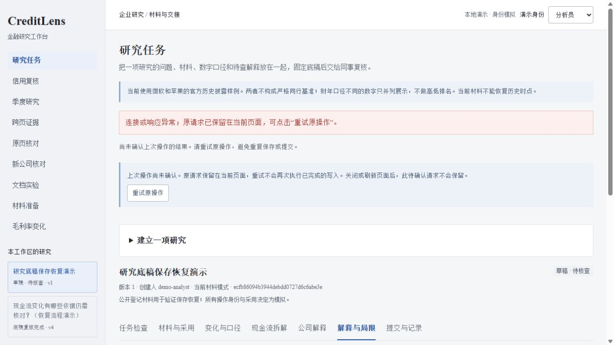
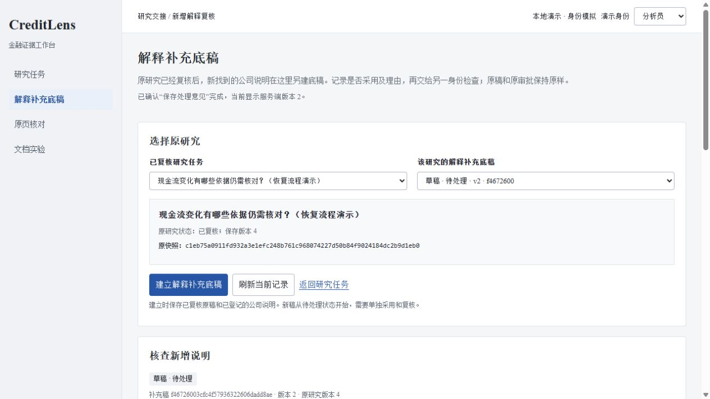

# 第37轮：保存结果未收到时，按原请求恢复

日期：2026-10-26。任务：分析员保存研究底稿、复核员提交处理意见后，如果页面没有收到结果，能够确认原操作是否完成，恢复最新记录并继续工作。

## 为什么做

独立审查复现了研究任务与解释补充稿的8类写路径：第一次写入完成后，丢弃返回值，再按旧版本发送同样内容都会遇到409。保存草稿时页面还保留未保存状态，刷新和任务切换又被阻止。原有CAS避免了覆盖，却没有完整解决“到底保存成功没有”的操作问题。

本轮沿用2026-10-25的[业务需求](../01-product-requirements.md)及[企业研究设计](../research/2026-10-25-enterprise-research-design.md)，服务已有材料采用和独立复核流程，没有新增客户访谈、使用规模或节省工时主张。固定任务与数据不变，不重复运行OCR或引入付费服务。

## 本轮完成

为研究任务和解释补充稿的保存、提交、退回、确认增加事务内写回执。带幂等键的相同请求取回首次完整响应，不重复产生版本、事件和快照；不同请求复用键会拒绝。访问身份、租户与自审限制在回放前重新检查。

两页面共用恢复组件。连接、响应或回读失败时保留原请求，明确提供重试入口，并暂停其他写入。拿到回执后再读当前版本，避免旧回执覆盖同事后来的更新；明确拒绝则保留草稿，允许显式放弃未保存内容后重新载入。身份切换和迟到响应分别隔离。

输入、正确标准、错误与恢复见[功能说明](../40-research-write-recovery.md)。

## 已验证

- 全套自动测试：1254项运行，1252项通过，2项Windows权限相关测试跳过，耗时252.052秒。新增19项存储回执测试和9组HTTP测试；既有无键调用继续验证原CAS行为。
- [固定复演](../../artifacts/research-write-retry.json)：56/56检查通过，12个成功意图对应12条回执，两类底稿各保留2份提交快照。保存报告的逐字段复验通过；响应损坏、回执故障、并发请求、权限变化和旧版本回放分别检查。
- [页面控制](../../scripts/check_research_write_retry_ui.js)：62项通过，覆盖请求或正文读取失败、无效JSON、明确拒绝、当前版本回读失败、身份切换与迟到响应、显式放弃草稿。
- [实际浏览器记录](../../artifacts/research-write-ui-verification.json)：隔离演示服务在两次PATCH已提交后分别注入503，页面重试使用原键，研究稿停留版本2；补充稿恢复到版本2后继续提交和独立复核至版本4。4个成功意图对应4条回执，旧原稿导出不变。下载251,145字节，与API响应逐字节一致。身份与处理意见为模拟，不是生产网络故障或真实用户效果。
- 132份既有冻结文件、19个既有只读API响应的长度与摘要均保持不变。Python编译、两页与共享脚本语法、Markdown链接检查通过；0.29.0 wheel构建并确认包含共享脚本。首次无构建隔离的打包因本机缺少setuptools未完成，改用隔离构建后成功，没有改变应用依赖。

## 独立审查与取舍

采用事务内回执、当前权限重查、回执与最新状态分开、同页原请求保留和明确放弃草稿入口。没有让客户端在失败后自动换新键，也没有自动重新提交复核。旧客户端不带键时仍按原CAS规则处理，旧导出结构不变。HTTP复演发现首次响应与回放的JSON字段顺序不同，已修正为带键路径首次返回与存储响应一致；原无键路径保留。页面审查同时修复了旧身份迟到回调可能影响新操作状态的问题。

## 范围与下一轮

当前恢复针对这两类底稿已有写接口；页面待确认请求只存在内存，刷新或关闭后不会自动恢复。没有新增通用文件入库、后台工作租约、任务崩溃续跑或消息队列。独立人工参考、未参与调参的材料、跨页续表与图表模型对照仍待验收，不能把重试控制计作财务回答正确率。
