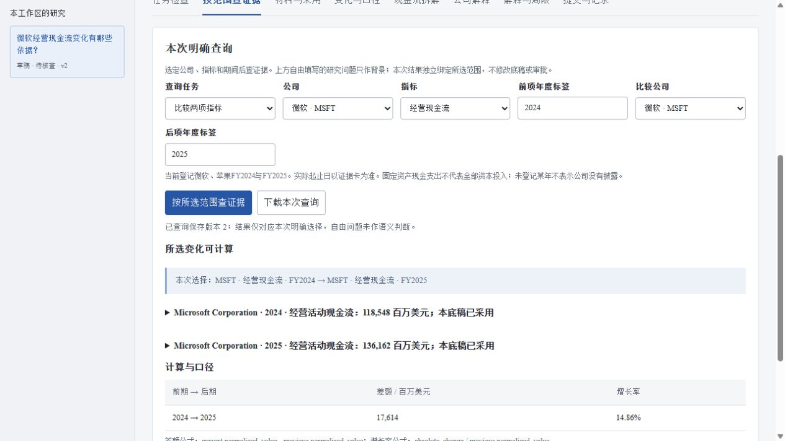
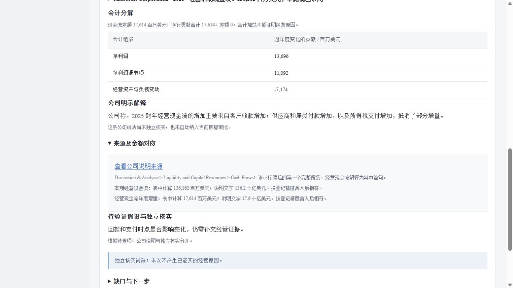

# 第38轮：选择范围后，只查这组证据

日期：2026-10-26。使用者任务：研究员明确选择公司、指标与期间后，得到相应的原文、可比性判断或经营变化依据。

## 为什么做

现有“任务检查”展示整份登记材料的能力与缺口，已经明确不理解自由填写的问题。实际操作还需要一个更窄的入口：选择微软 FY2025 经营现金流时，只看这一项；选择两期时，先检查能不能计算，再给出公式。整套材料相关，不代表已经回答了本次选择。

本轮沿用2026-10-25的[业务需求](../01-product-requirements.md)和[企业研究设计](../research/2026-10-25-enterprise-research-design.md)中分析员查数、对齐口径和交接证据的任务，以及已有官方产品、论文和岗位调研。未新增客户访谈、真实使用者反馈或效率数据。优先完成明确任务、来源绑定和失败恢复，未扩大训练、付费或大文件下载范围。

## 本轮完成

新增只读结构化查询接口与“按范围查证据”视图。查一个指标返回所选证据卡；比较按有顺序的两项输入检查采用、公司、指标和实际期间；经营依据分别呈现会计分解、公司说法、待查假设及独立核实缺口。

字段严格校验，未登记组合不补零、不推定未披露，倒序与重复输入不自动纠正。只使用所选范围的来源绑定，查询摘要、材料摘要与当前任务版本一起返回。自由标题不会改变结果，旧任务、审批和冻结报告保持原样。

页面改选、编辑、切换任务或身份后清掉旧结果；迟到响应不能覆盖新范围。服务失败时说明需重新载入或修正的地方。查询和下载都核对任务、版本、材料及所选证据身份，下载保存服务端原始响应。输入、正确标准、常见错误和恢复方法见[功能说明](../41-explicit-research-queries.md)。

## 已验证

- 全套测试1302项运行，1300项通过，2项Windows权限相关测试跳过，耗时280.424秒；该次包含24项核心、15项实验和9项新增API测试。随后修复换行摘要差异，实验定向回归扩充至16项并全部通过；未重复整套本地测试。
- [固定开发复演](../../artifacts/research-query-report.json)：32项符合预期，包含10项登记材料投影与22项合成控制；3项不变性检查通过。预期数值固定在实验脚本中，数值、引用、拒绝及来源绑定分别验收。保存报告按完整字段重放，不只比较汇总数量。
- [页面控制](../../scripts/check_research_query_ui.js)：51项通过，涵盖改选、编辑、身份变化、迟到响应、输入错误、服务失败、材料错配和原响应导出。使用正式报告的5组响应作为夹具；控制时序是模拟，真实页面另测。
- [浏览器与HTTP记录](../../artifacts/research-query-ui-verification.json)：微软单项查询返回136,162百万美元；两期比较差额17,614，页面显示增长率14.86%；跨公司停算；苹果解释目录未登记时保留不足。会计分解、公司解释和模拟待查项分别显示，未被升级为原因。只读访客可查询；下载15,655字节，与API原响应一致。
- 134份旧冻结文件、19个旧只读API响应的长度与摘要保持不变，演示任务查询前后的记录摘要相同。没有重新下载原始PDF、整页图或OCR，也没有运行新模型。Python编译、JavaScript语法及Markdown链接检查通过；0.30.0 wheel构建成功，查询核心、路由和页面资源均在包内。

## 独立审查与取舍

复用三条隔离分支，核心、实验和顾问分别提交，main检查差异后逐项合入。[顾问审查](../research/advisory-29.md)采纳两项补强：页面不能只凭任务ID和版本接收结果，还要核对材料及所选卡；公司说明中的本期金额和年度增量要分别显示表内金额、披露金额及单位。已在页面控制和真实浏览器复验。

保留固定任务的原接口与报告格式，查询只投影当前登记材料，不写入旧审批。没有为标题加入未经验证的语义解析，没有用公司说明补成独立核实。报告篡改金额、能力范围或不变性摘要，即使通过数量相同也会被完整复演拒绝。整合时发现主工作树与隔离分支的CRLF/LF换行使两份仓库JSON摘要不同，已将本轮报告明确改为UTF-8、LF规范化摘要并补回归；实际内容改写仍拒绝，旧事实包未改动。

## 仅设计、阻塞与下一步

通用自然语言问题理解、真实独立人工参考、未参与开发的新公司评测、历史可得版本及因果验证仍未完成。当前无本任务组发布阻塞；这些是更广能力的验收门槛，不能以32项开发控制替代。下一组优先把参考核对流程用于真实人员确认的材料，再评估模型能否正确选择证据；跨页续表与图表对照继续按合法数据和固定验收推进。
