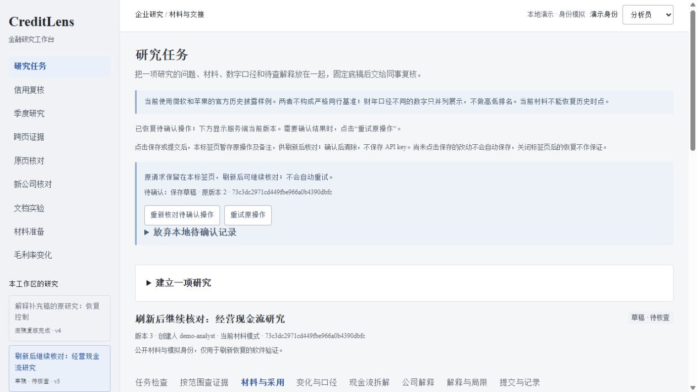
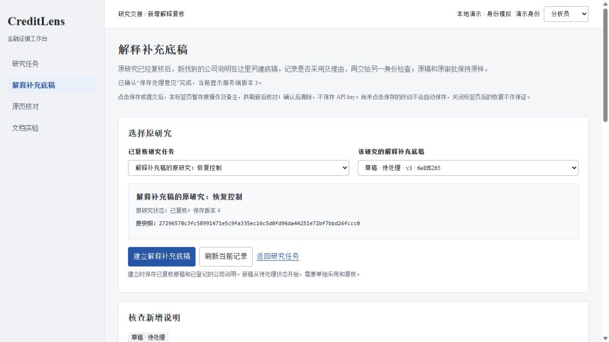

# 第39轮：刷新后继续核对原操作

日期：2026-10-26。使用者任务：分析员或复核员在保存、提交后没有收到结果，刷新页面后仍能确认原操作，避免重新创建一次写入。

## 为什么做

第37轮解决了同页重试，但刷新会丢失内存中的原请求。研究备注、采用决定和复核说明已经发送，服务端可能已经完成操作，浏览器却无法判断；这会妨碍继续交接。本轮沿用2026-10-25的[需求与企业任务设计](../research/2026-10-25-enterprise-research-design.md)及已有岗位、官方产品调研，没有新增客户访谈或效率结论。

优先把原请求保留、身份核对、当前版本读取和显式重试一起接通。用户本轮将自动复核改为每2小时；触发频率不影响已经开始的任务组继续完成。

## 本轮完成

研究任务与解释补充稿在发送写请求前，将小型原请求和幂等键保存在本标签页的会话存储中，再读回检查。记录包含这次备注和采用决定，不保存 API key 或完整服务端响应；存储失败时不先发送一个无法恢复的请求。

刷新后重新取得服务端身份，检查租户、用户、角色和固定请求结构，再读取对应任务当前版本。页面显示原操作名称与原版本，当前已保存记录单独呈现。只有点击重试，才发送原正文和原幂等键，不用较新的版本改写这次请求。

损坏、身份不符、目标不匹配、存储不可用和清理失败分别保留提示。明确放弃本地记录不会撤销服务端操作；成功结果读回而本地清除失败时，仍阻止下一笔写入。四项验收与详细边界见[恢复流程](../40-research-write-recovery.md)和[存储契约](../research/write-journal-contract.md)。

## 已验证

- 41项相关Python测试通过，覆盖事务回执、原写接口和13项新应用重建测试，耗时72.398秒。随后调整实验代码绑定并扩充至16项定向测试，16项全部通过，耗时59.331秒。此次没有因页面改动重复运行整套本地测试。
- [共享模块控制](../../scripts/check_research_write_journal.js)47项、[刷新页面控制](../../scripts/check_research_reload_ui.js)60项通过；旧写入62项和范围查询51项保持通过。新页面控制使用全新VM共享模拟sessionStorage，区分真实浏览器验证。
- [应用重建复演](../../artifacts/research-restart-report.json)在同一Python进程建立13个应用实例，完成12次重建；61项检查通过，八个已完成带键操作对应八条回执。四类写入的首次响应逐字节复放，旧回执不回退新的当前记录；临时来源变化、未提交连接关闭和回执写失败分别检验。
- [实际浏览器记录](../../artifacts/research-reload-ui-verification.json)包含研究保存、提交、复核确认及补充稿保存四个操作。隔离中间件在服务端完成后将首次响应替换成503；真实刷新后主动重试，四组请求均保持同一键、同一正文摘要，回放响应与首次服务端响应字节相同。研究终态版本5、5事件、1快照，补充稿版本3、3事件、0快照，没有因重试增加事件。
- 实际复核请求刷新后默认回到分析员身份，页面阻止重试且不展示原请求正文；切回复核员才能继续。验收后已关闭预览故障注入，普通预览保留原数据库。
- 136份旧数据及报告文件、19个旧只读接口响应保持一致。Python编译、浏览器JavaScript语法和文档链接检查通过；0.31.0 wheel采用隔离构建成功，新脚本随包交付。无隔离构建尝试因本地环境缺少setuptools失败，没有以此修改运行环境或锁定依赖。

## 独立审查与取舍

三条隔离分支分别负责存储及控制器、应用重建复演、独立审查和页面控制，main接通两个页面、静态资源、实际浏览器和发布检查。[顾问意见](../research/advisory-30.md)采纳了写前回读、身份不符不展示正文、固定目标白名单、清理失败继续阻断，以及旧回执和当前版本分开读取。

主开发进一步补查部分存储写入失败：即使本次网络请求尚未发出，只要本地已经留下记录，也必须同步恢复状态，不能把后续保存卡在不可处理的旧记录上。新控制已覆盖这一情况。实现摘要只应绑定本实验使用的业务代码，无关静态路由的增加不应迫使旧实验改写，相关绑定另行定向验证。

## 仅设计、阻塞与下一步

本任务组没有剩余功能阻塞。同一标签页刷新恢复不等于关闭标签页、跨设备草稿、操作系统崩溃恢复或后台队列。未点击保存的表单不自动保存。本地记录可被本机或同源脚本改写，不是授权凭证，服务端权限、CAS与复核限制继续生效。

没有新增金融事实、原始大文件、OCR调用、模型训练或真实独立人工参考。跨页续表、图表及未参与调参材料的独立参考仍待验收；下一组应按合法材料与实际参考条件选择，不把本轮软件恢复数量换成模型准确率。
